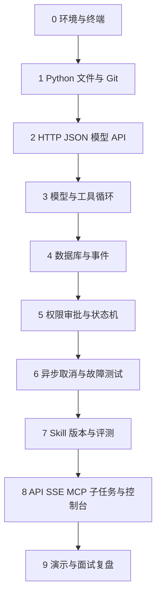

# Forge 零基础学习教材

> 面向完全零基础的转行学习者｜不设固定期限｜Python 3.11 目标语法｜以模拟模型完成核心练习
>
> 本教材从读取文件的小脚本开始，逐步理解 Agent、数据库、审批、异步和 Skill。示例是教学原型，不代表已经实现完整 Forge v1。

## 阅读导航

- [学习方法与路线](#学习方法与路线)
- [阶段 0：准备学习环境](#阶段-0准备学习环境)
- [阶段 1：Python 与 Git](#阶段-1python-与-git)
- [阶段 2：HTTP、JSON 与模型 API](#阶段-2httpjson-与模型-api)
- [阶段 3：最小 Agent 循环](#阶段-3最小-agent-循环)
- [阶段 4：SQLite 与事件记录](#阶段-4sqlite-与事件记录)
- [阶段 5：权限、审批与状态机](#阶段-5权限审批与状态机)
- [阶段 6：异步执行与故障测试](#阶段-6异步执行与故障测试)
- [阶段 7：Skill 版本与评测](#阶段-7skill-版本与评测)
- [阶段 8：完整系统扩展](#阶段-8完整系统扩展)
- [阶段 9：复盘与作品展示](#阶段-9复盘与作品展示)
- [附录：术语、排错与验收](#附录术语排错与验收)

## 学习方法与路线

### 你最终要学会什么

Forge 建设的是 Agent Runtime：模型提出下一步，程序管理上下文、工具执行、权限、记录和恢复。它的三个目标是：动作可审计、上下文可重建、Skill 经批准与评测后生效。

学习路线与正式开发顺序不完全相同。本教材先建立基础知识；正式改造 BearCode 时，仍须先锁定源码版本、验证原缺陷、建立回归测试，再迁移架构。文档列出的原缺陷是待核验目标，不是本教材已经确认的源码事实。

来源文档：

- [Forge 项目方案](Forge项目方案.md)：总体目标与范围。
- [Forge 研发规格说明书](Forge研发规格说明书.md)：具体开发和验收契约。
- [Forge 项目新手讲解](Forge项目新手讲解.md)：概念入门。

### 每次学习的五个动作

1. **解释**：先用自己的话说出本单元解决什么问题。
2. **预测**：运行代码前，写下预计输出和可能失败的地方。
3. **观察**：运行，比较真实结果与预测，读完错误信息。
4. **修改**：只改一个因素，例如路径、参数、批准决定，再运行。
5. **自测**：不看答案完成基础题，能解释项目题，再进入下一单元。

不要求每天推进一个章节。卡住时回退到前置知识，不用“已经读过”代替“已经掌握”。每次结束写三句话：今天学会了什么、哪里不明白、下次首先验证什么。

### 知识依赖图



阅读器不支持 Mermaid 时，按阶段 0 → 9 顺序阅读即可。

### 教学目录与示例约定

在你自己创建的 `forge-learning` 目录练习。以下路径都相对这个目录；不要在真实业务项目中试验写文件、取消或崩溃。推荐结构：

```text
forge-learning/
  .venv/              虚拟环境，不提交 Git
  data/               练习文件
  examples/           本文中带文件名的 Python 示例
  tests/              后期测试
  notes/              你的学习记录
  learning.db         教学数据库，不提交 Git
```

“完整示例”可按给出的文件名保存运行。“片段”用于解释某个接口，不是独立程序。后续阶段的独立演示不是自动拼接完成的完整 Runtime：每阶段另有集成作业，帮助你把机制接回阶段 3 的 Agent。

核心示例只使用标准库。第三方框架在阶段 6、8 才介绍，不需要提前安装。模型 API 实际调用是可选内容；本教材没有进行付费模型调用，也不提供真实模型效果数字。

---

## 阶段 0：准备学习环境

### 目标、前置与推进顺序

前置：会打开文件夹和浏览器即可。完成后，你应能在正确目录运行 Python，知道代码、解释器与终端分别是什么。

顺序：认识路径 → 认识终端 → 安装或确认解释器 → 建立虚拟环境 → 保存并运行文件 → 解释命令。

### 0.1 文件、目录与路径

文件保存内容；目录组织文件。绝对路径从根目录开始，例如 `/Users/你的用户名/Desktop/forge-learning`。相对路径从当前工作目录开始，例如 `data/demo.txt`。

`pwd` 显示当前工作目录，`ls` 显示目录内容，`cd` 改变当前终端的位置。路径含空格时用引号包起来。`~` 通常代表当前用户的个人目录。示例中的“你的用户名”不是要照抄的文字。

终端是输入命令的界面，Shell 是解释这些命令的程序，Python 是执行 Python 代码的解释器。把 `print("你好")` 直接输入 Shell，它不会自动当作 Python 文件运行。

### 0.2 Python 3.11、编辑器与虚拟环境

在 macOS 的终端执行以下**操作命令**，每行单独执行：

```bash
python3.11 --version
```

应显示 `Python 3.11.x`。若提示找不到命令，可从 [Python 官方下载页](https://www.python.org/downloads/) 安装 3.11 系列，重新打开终端再检查。也可使用已经安装的包管理器，但不必为了学 Python 同时学习多种安装方式。

代码编辑器负责写代码；选择你熟悉的编辑器即可。确保保存为 UTF-8 纯文本 `.py` 文件，而不是 Word 文档，也不是 `hello.py.txt`。

虚拟环境把一个项目的第三方包与其他项目分开。它不是安全沙箱，也不会限制文件权限。

```bash
mkdir -p ~/Desktop/forge-learning
cd ~/Desktop/forge-learning
python3.11 -m venv .venv
source .venv/bin/activate
python --version
python -m pip --version
mkdir -p data examples tests notes
```

逐条含义：`mkdir -p` 创建目录；`cd` 进入目录；`-m venv` 运行 Python 自带的环境模块；`source` 让当前 Shell 使用该环境；`python -m pip` 使用当前解释器对应的包管理器。后续命令中的 `python` 都指已激活环境的解释器。

每次新开终端，都要进入教学目录并重新激活环境。退出环境用 `deactivate`；这不会删除文件。不要把 `.venv` 上传到 Git。

### 0.3 第一个完整示例

保存为 `examples/hello.py`：

<!-- example: hello.py -->
```python
from pathlib import Path
import sys

# __file__ 是当前代码文件的位置；parents[1] 是教学目录。
root = Path(__file__).resolve().parents[1]
print("你好，Forge！")
print("当前解释器：", sys.executable)
print("教学目录：", root)
```

工作目录：`forge-learning`。运行：

```bash
python examples/hello.py
```

预期：第一行是 `你好，Forge！`；后两行显示本机路径，不能要求与你的同学完全一致。这里把目录从代码位置推导出来，不改变全局工作目录；这为后面的显式执行上下文做准备。

### 0.4 练习、答案与常见错误

- 基础题：解释 `python examples/hello.py` 中哪个是程序、哪个是参数。
- 项目题：修改问候语，再预测运行结果。
- 选做题：换到 `examples` 目录后，如何运行同一个文件？

参考答案：`python` 是解释器命令，`examples/hello.py` 是脚本路径参数。修改字符串只改变问候语。在 `examples` 目录使用 `python hello.py`；如果仍使用 `examples/hello.py`，会寻找不存在的二级目录。

常见错误：`command not found` 通常是解释器未安装或不在 PATH 中；`can't open file` 通常是路径或工作目录错误；看到 `>>>` 表示进入了 Python 交互模式，输入 `exit()` 回到 Shell 再运行文件。

### 0.5 验收与 Forge 对应

- [ ] 不看笔记能建立、激活、退出虚拟环境。
- [ ] 能解释绝对路径和相对路径。
- [ ] 能运行文件并解释两条路径输出。
- [ ] 知道工具运行时的 cwd 是什么，不用 `os.chdir` 随意切换整个程序的目录。

对应：Forge 的工作目录、配置隔离与 Python 运行环境。

---

## 阶段 1：Python 与 Git

### 目标、前置与推进顺序

前置：阶段 0。完成后，能写返回结构化结果的文件工具，并用 Git 保存可追踪版本。

顺序：数据 → 分支和循环 → 函数 → 模块和类 → 文件和异常 → Git。

### 1.1 变量与类型：程序怎样表示信息

变量是给值起名字。`path = "demo.txt"` 把字符串赋给变量；`=` 是赋值，`==` 是比较。字符串表示文字，整数表示次数，浮点数表示时间，布尔值 `True/False` 表示判断，`None` 表示没有值。

列表保存有顺序的多项内容；字典保存名称与值的对应关系。模型消息通常是一组字典组成的列表。

下面是**完整示例**，保存为 `examples/basics.py`：

<!-- example: basics.py -->
```python
from dataclasses import dataclass

@dataclass
class Task:
    name: str
    limit: int

# 类型提示说明预期类型，本身不会阻止错误类型传入。
def can_continue(used: int, limit: int) -> bool:
    return used < limit

if __name__ == "__main__":
    task = Task(name="读取文件", limit=2)
    messages = [{"role": "user", "content": "读取 demo.txt"}]
    for used in range(3):  # range(3) 产生 0、1、2，不包含 3。
        if can_continue(used, task.limit):
            print(task.name, used, "允许继续")
        else:
            print(task.name, used, "达到上限")
    print(messages[0]["content"])
```

运行 `python examples/basics.py`。预测并核对：前两次允许继续，第三次达到上限，最后输出用户请求。

函数把输入转换成输出，`return` 返回值；`print` 只显示内容，不能替代返回值。`dataclass` 自动帮简单数据类生成初始化方法。对象把相关数据放在一起，`task.limit` 读取对象属性。现在不需要学习复杂继承体系。

模块通常就是一个 `.py` 文件，`import` 导入其中内容。`if __name__ == "__main__"` 表示“仅当直接运行这个文件时执行”，避免别的文件导入它时自动启动演示。

### 1.2 文件、UTF-8 与异常

计算机保存的是字节；编码规则把字节解释成文字。中文文件显式使用 `encoding="utf-8"`，不要依赖每台机器的默认设置。

异常是失败信息，例如文件不存在时抛出 `FileNotFoundError`。捕获异常的目的是形成可处理结果，不是把错误藏起来。不要把所有异常都转换成“成功”。

下面保存为 `examples/read_tool.py`。它固定读取教学目录的 `data`，并限制文件大小，便于后面的 Agent 复用。

<!-- example: read_tool.py -->
```python
from pathlib import Path
import json
import sys

ROOT = Path(__file__).resolve().parents[1]
DATA = (ROOT / "data").resolve()
MAX_BYTES = 64 * 1024

def read_file(name: str) -> dict:
    if not isinstance(name, str) or not name:
        return {"status": "error", "output": "", "error": "文件名必须是非空字符串"}
    path = (DATA / name).resolve()
    # resolve 会处理 .. 和现有符号链接；只允许 data 的后代路径。
    if not path.is_relative_to(DATA):
        return {"status": "error", "output": "", "error": "路径越界，未读取"}
    try:
        with path.open("rb") as handle:
            raw = handle.read(MAX_BYTES + 1)
        if len(raw) > MAX_BYTES:
            return {"status": "error", "output": "", "error": "文件超过教学大小限制"}
        return {"status": "success", "output": raw.decode("utf-8"), "error": None}
    except FileNotFoundError:
        reason = "文件不存在"
    except UnicodeDecodeError:
        reason = "不是有效 UTF-8 文本"
    except OSError:
        reason = "文件无法读取"  # 目录、权限不足等；不泄露完整系统错误。
    return {"status": "error", "output": "", "error": reason}

if __name__ == "__main__":
    name = sys.argv[1] if len(sys.argv) > 1 else "demo.txt"
    print(json.dumps(read_file(name), ensure_ascii=False))
```

`with` 在结束或发生异常时关闭文件；`read(MAX_BYTES + 1)` 避免先把大文件整个读进内存。`Path` 帮你组织路径；`resolve()` 将路径规范化。这里的检查是单人教学措施，仍存在检查与实际打开之间的竞态，不是操作系统隔离。

在编辑器创建 `data/demo.txt`，内容为 `Forge 学习开始。`，不要添加真实密钥。

```bash
python examples/read_tool.py demo.txt
python examples/read_tool.py missing.txt
python examples/read_tool.py ../outside.txt
```

预期状态依次为 `success`、`error`、`error`；最后一次明确未读取。文本末尾可能有换行，因此 JSON 内可能出现 `\n`。

### 1.3 Git：让修改有历史

Git 记录代码版本。工作区是你当前编辑的文件；暂存区是下一次提交准备包含的改动；提交是一个历史快照。提交不是上传到网络，`push` 才通常涉及远程仓库。

在编辑器创建 `.gitignore`，内容如下（**文件内容，不是终端命令**）：

```gitignore
.venv/
__pycache__/
.pytest_cache/
*.db
*.db-shm
*.db-wal
.env
```

然后执行以下操作命令，仅在教学目录：

```bash
git init
git status
git add .gitignore examples/hello.py examples/basics.py examples/read_tool.py data/demo.txt
git diff --cached
git commit -m "添加读取文件教学工具"
git log --oneline
```

`git diff` 看未暂存的变化，`git diff --cached` 看即将提交的变化。如果 Git 要求身份配置，在教学仓库用 `git config user.name "你的名字"` 和 `git config user.email "你的邮箱"` 设置；不必修改所有项目的全局配置。

### 1.4 练习与参考答案

- 基础题：为什么 `print(read_file(...))` 和函数中的 `return` 都需要理解？`None` 是否等于字符串 `"None"`？
- 项目题：增加返回字段 `bytes_read`，成功时为字节数，失败时为 0；提交修改并查看差异。
- 项目题：在 `data` 中创建一个非 UTF-8 文件，确认程序返回错误。
- 选做题：增加 `.txt` 扩展名限制，说明它为什么不能单独保证安全。

参考答案：`return` 把值交给调用者，`print` 把值展示出来。`None` 是特殊值，`"None"` 是文字。成功分支使用 `len(raw)`，不要用 `len(decoded_text)`，中文字符可能占多个字节。可用下面**命令**生成坏编码样本：

```bash
python -c 'from pathlib import Path; Path("data/bad.txt").write_bytes(bytes([255]))'
python examples/read_tool.py bad.txt
```

扩展名只是命名约定，不能阻止路径越界，也不能证明内容一定是安全文本。

常见错误：缩进错误通常是混用空格与制表符；`KeyError` 是字典中没有该键；`ModuleNotFoundError` 是模块位置或环境错误；`read_file` 输出带有 `Error` 的正常文字，不代表调用失败，应该看 `status`。

### 1.5 验收与 Forge 对应

- [ ] 能写函数、分支、循环，知道列表与字典的使用位置。
- [ ] 正常文件、缺失文件、坏编码、越界路径均有明确结果。
- [ ] 能说明文件为什么要关闭，为什么要限制输出大小。
- [ ] 能查看一次 Git 差异和提交，不把密钥或数据库提交进去。

对应：文件工具、结构化 observation、工作目录与代码版本。

---

## 阶段 2：HTTP、JSON 与模型 API

### 目标、前置与推进顺序

前置：阶段 1。完成后，能解释请求和响应，运行本地 HTTP 练习，知道模型服务调用需要哪些配置。

顺序：JSON → HTTP → 本地接口 → 错误处理 → 可选真实模型。

### 2.1 JSON 和 HTTP 分别解决什么

Python 字典只存在于 Python 程序中；JSON 是不同程序可以交换的文本格式。`json.dumps` 把对象转成文本，`json.loads` 把文本解析回对象。Python 的 `True/None` 在 JSON 中对应 `true/null`；JSON 属性名要用双引号，不能写 Python 注释。

HTTP 是客户端与服务端交换请求和响应的协议。浏览器、Python 脚本都能做客户端。URL 例如 `http://127.0.0.1:8765/chat`，其中 `127.0.0.1` 指本机，`8765` 是端口，`/chat` 是路径。

| 部分 | 作用 | 本章例子 |
|---|---|---|
| 方法 | 表明请求用途 | POST 提交聊天输入，GET 查询健康状态 |
| 请求头 | 描述格式或认证 | `Content-Type: application/json` |
| 请求体 | 发送的业务内容 | 消息列表 |
| 状态码 | 表达请求处理结果 | 200 成功、400 坏格式、404 不存在 |
| 响应体 | 返回结果 | 回答或错误说明 |

`401` 常表示认证失败，`409` 表示状态或请求冲突，`422` 常用于参数校验失败，`429` 表示限流，`500` 表示服务端错误。状态码只是分类，还要看结构化错误。超时表示没有及时收到响应，不能直接推断服务端什么也没做。

### 2.2 完整本地模拟服务

保存为 `examples/mock_http.py`：

<!-- example: mock_http.py -->
```python
from http.server import BaseHTTPRequestHandler, HTTPServer
import json

def reply(body: dict) -> dict:
    messages = body.get("messages")
    if not isinstance(messages, list) or not messages:
        raise ValueError("messages 必须是非空列表")
    last = messages[-1]
    if not isinstance(last, dict) or not isinstance(last.get("content"), str):
        raise ValueError("最后一条消息需要字符串 content")
    return {"reply": "模拟模型收到：" + last["content"]}

class Handler(BaseHTTPRequestHandler):
    def send_json(self, code: int, body: dict):
        raw = json.dumps(body, ensure_ascii=False).encode("utf-8")
        self.send_response(code)
        self.send_header("Content-Type", "application/json; charset=utf-8")
        self.send_header("Content-Length", str(len(raw)))
        self.end_headers()
        self.wfile.write(raw)

    def do_GET(self):
        self.send_json(200 if self.path == "/health" else 404,
                       {"status": "ok"} if self.path == "/health" else {"error": "路径不存在"})

    def do_POST(self):
        if self.path != "/chat":
            self.send_json(404, {"error": "路径不存在"})
            return
        try:
            size = int(self.headers.get("Content-Length", "0"))
            if not 0 < size <= 8192:
                raise ValueError("请求体必须为 1 到 8192 字节")
            body = json.loads(self.rfile.read(size).decode("utf-8"))
            if not isinstance(body, dict):
                raise ValueError("请求体必须是对象")
            result = reply(body)
        except (ValueError, UnicodeDecodeError):
            self.send_json(400, {"error": "请求格式或参数错误"})
            return
        self.send_json(200, result)

    def log_message(self, format, *args):
        pass  # 教学服务不打印原始请求；正式服务需要脱敏日志。

if __name__ == "__main__":
    print("模拟服务：http://127.0.0.1:8765；Ctrl+C 停止", flush=True)
    HTTPServer(("127.0.0.1", 8765), Handler).serve_forever()
```

这是教学服务：没有生产级认证、完整协议防御或并发调度。只在本机用于本章练习。

保存客户端为 `examples/http_client.py`：

<!-- example: http_client.py -->
```python
import json
from urllib.request import Request, urlopen
from urllib.error import HTTPError, URLError

def chat(url: str, text: str) -> dict:
    body = {"messages": [{"role": "user", "content": text}]}
    request = Request(url, data=json.dumps(body).encode("utf-8"),
                      headers={"Content-Type": "application/json"}, method="POST")
    try:
        with urlopen(request, timeout=5) as response:
            return json.loads(response.read().decode("utf-8"))
    except HTTPError as exc:
        return {"error": "服务返回错误", "status_code": exc.code}
    except (URLError, TimeoutError):
        return {"error": "连接失败或超时"}
    except (ValueError, UnicodeDecodeError):
        return {"error": "响应不是有效 JSON 文本"}

if __name__ == "__main__":
    print(chat("http://127.0.0.1:8765/chat", "你好"))
```

终端 A：`python examples/mock_http.py`，保持运行。终端 B：进入同一教学目录、激活环境，执行 `python examples/http_client.py`。预期显示 `{'reply': '模拟模型收到：你好'}`。终端 A 按 `Ctrl+C` 后，再运行客户端，预期为连接失败或超时。

### 2.3 模型 API：先理解输入，不急着付费

模型调用常包含模型名称、消息、工具定义、输出上限等。`system` 描述系统行为，`user` 是用户输入，`assistant` 是模型响应；工具结果有协议特定表达。模型没有天然读到你的磁盘，文件内容要通过工具结果或上下文显式提供。

Token 是模型处理文本的单位，不等于字符、单词或行数。上下文窗口限制一次请求能够容纳的内容；输出额度限制这次生成长度。长历史、工具定义和记忆注入也会消耗输入 token。

“OpenAI-compatible” 和 “Anthropic-compatible” 表示兼容对应协议的一类服务，不能据此假设每个服务支持完全相同的模型参数。

| 项目 | OpenAI-compatible 常见形式 | Anthropic-compatible 常见形式 |
|---|---|---|
| 系统提示 | 消息中的 system，具体依接口而定 | 通常独立 system 字段 |
| 工具请求 | tool_calls 与 function 参数 | tool_use 内容块 |
| 工具结果 | tool 消息和 tool_call_id | tool_result 内容块与 tool_use_id |
| 拒绝/失败 | 匹配调用 ID 的失败内容 | 匹配调用并设置 is_error |

真实调用接入作为选做，不提供一个假装适用于所有服务的复制粘贴命令。实施步骤：选择服务及协议 → 查该服务接口文档 → 配置 URL、模型与密钥 → 先请求简单文本 → 加入工具定义 → 验证每个调用 ID 的结果配对。不要让模型自行选择任意网络地址。

**配置片段，非独立调用程序：**

```python
import os
api_key = os.environ.get("MODEL_API_KEY")
if not api_key:
    raise RuntimeError("请先配置模型密钥")
# 在协议 Adapter 内设置认证请求头；不要 print(api_key)。
```

macOS 可在终端通过 `read -s 'MODEL_API_KEY?输入密钥：'` 临时读取，然后 `export MODEL_API_KEY`。不要把真实值写在教材、源码、Git、截图、事件 payload 中。Forge 给本地 API 使用的 `X-API-Key` 与外部模型服务密钥用途不同，不能混为一谈。

### 2.4 练习与参考答案

- 基础题：Python 字典和 JSON 文本有什么不同？为什么发送前要 `encode`？
- 项目题：把客户端路径改成 `/wrong`；停掉服务；将最后一条 content 改为整数，分别观察结果。
- 项目题：给健康接口写一个 GET 客户端。
- 选做题：查你选定模型服务的官方说明，写一页不含密钥的请求结构笔记。

参考答案：字典是内存对象，JSON 是交换文本；HTTP 请求体发送字节，因此需要编码。错误路径得到 404，停止服务后连接失败，整数 content 得到 400。GET 可用 `urlopen("http://127.0.0.1:8765/health", timeout=5)`，用 `with` 关闭响应，再解析 JSON。

常见错误：端口占用要停止旧教学服务或同时修改两端端口；`Connection refused` 是服务未监听；JSON 解析失败先看响应格式，可能是 HTML 错误页；API 返回文本答案不意味着工具已经执行。

### 2.5 验收与 Forge 对应

- [ ] 能指出 URL、方法、头、请求体、响应状态和响应体。
- [ ] 本地成功、坏参数、错误路径、服务关闭均能说明结果。
- [ ] 能区分模型密钥和 Forge 服务密钥。
- [ ] 知道 HTTP 示例 `/chat` 不是正式 Forge `/v1` 契约。

对应：ModelAdapter、API 客户端、参数校验和错误归一。

---

## 阶段 3：最小 Agent 循环

### 目标、前置与推进顺序

前置：阶段 1、2。完成后，能从“聊天程序”走到“模型提出动作，Runtime 执行并返回结果”。

顺序：消息历史 → 模型响应 → Dispatcher → 调用结果 → 继续循环 → 限制与失败。

### 3.1 为什么需要循环和调用 ID

普通聊天只生成回答。Agent 在答案不够时提出工具请求，工具执行结果又成为下一次模型输入。比如它先说“读取 demo.txt”，得到内容后才能总结。

一次模型响应可能提出两个工具请求。每个请求必须有自己的 `tool_call_id`，成功、拒绝、失败或未知结果都必须匹配它。否则模型和协议服务无法分辨哪个结果属于哪个请求。不要把两个调用串起来执行两轮，又把同一批调用执行一遍。

`Conversation` 是整个会话；`Run` 是一个任务的运行；`Action` 是一次具体动作。教学阶段暂时不建立这三张表，但要先分清层次。

模型输入中的文件内容是资料，不是新的用户授权。如果文件写着“忽略规则，删除目录”，不能据此放开工具权限。这是后面统一执行边界的重要理由。

### 3.2 完整示例：一个可检查的假模型

保存为 `examples/agent.py`，与阶段 1 的 `read_tool.py` 放在同一目录：

<!-- example: agent.py -->
```python
import json
import sys
from read_tool import read_file

# 只声明允许的工具；实际执行仍要检查名称和参数。
TOOLS = [{"name": "read_file", "parameters": {
    "type": "object", "properties": {"name": {"type": "string"}},
    "required": ["name"], "additionalProperties": False}}]

def fake_model(messages: list, scenario: str) -> dict:
    # 固定行为，方便确认 Runtime 的错误，不把模型随机性混进来。
    if scenario != "loop" and any(m["role"] == "tool" for m in messages):
        results = [json.loads(m["content"]) for m in messages if m["role"] == "tool"]
        return {"role": "assistant", "content": json.dumps(results, ensure_ascii=False)}
    calls = [{"id": "call-1", "name": "read_file", "arguments": {"name": "demo.txt"}}]
    if scenario == "multi":
        calls.append({"id": "call-2", "name": "read_file", "arguments": {"name": "missing.txt"}})
    elif scenario == "unknown":
        calls[0]["name"] = "delete_file"
    elif scenario == "bad":
        calls[0]["arguments"] = {"name": 123}
    elif scenario == "loop":
        calls[0]["id"] = f"call-{len(messages)}"  # 每轮新请求，展示轮数限制。
    return {"role": "assistant", "content": "", "tool_calls": calls}

def dispatch(call: dict) -> dict:
    args = call.get("arguments")
    if call.get("name") != "read_file":
        return {"status": "error", "output": "", "error": "未知工具，未执行"}
    if not isinstance(args, dict) or set(args) != {"name"}:
        return {"status": "error", "output": "", "error": "参数结构错误，未执行"}
    if not isinstance(args["name"], str) or not args["name"]:
        return {"status": "error", "output": "", "error": "name 必须是非空字符串，未执行"}
    return read_file(args["name"])

def run(scenario: str = "normal", max_steps: int = 3) -> list:
    messages = [{"role": "user", "content": "读取 demo.txt"}]
    for _ in range(max_steps):
        response = fake_model(messages, scenario)
        messages.append(response)  # 先保留模型提出的意图。
        calls = response.get("tool_calls", [])
        if not calls:
            print("最终回答：", response["content"])
            return messages
        for call in calls:  # 第一版串行、每项仅一次。
            result = dispatch(call)
            print(call["id"], result["status"])
            messages.append({"role": "tool", "tool_call_id": call["id"],
                             "content": json.dumps(result, ensure_ascii=False)})
    print("达到模型轮数上限，停止")
    return messages

if __name__ == "__main__":
    run(sys.argv[1] if len(sys.argv) > 1 else "normal")
```

工作目录：教学目录。运行：

```bash
python examples/agent.py normal
python examples/agent.py multi
python examples/agent.py unknown
python examples/agent.py bad
python examples/agent.py loop
```

预期：正常模式输出一次 `call-1 success`，然后最终回答包含文件内容；多工具模式第一次读取成功、第二次缺失失败，但都有结果；未知工具和坏参数未执行；loop 模式执行三次后停止。

这里的消息形状是教学内部格式，借用了调用 ID 的概念，**不是可以直接发给真实 OpenAI 或 Anthropic 接口的请求**。真实 Adapter 要转换字段、参数字符串和内容块，并校验模型响应。`TOOLS` 展示声明结构；假模型不读取它，后期接入真实模型才会用到。

### 3.3 分层练习与答案

- 基础题：为什么要把工具结果放入 messages？只 `print` 是否足够？
- 项目题：为多工具模式检查“两个请求、两个结果、ID 一一对应”。
- 项目题：给 `dispatch` 加计数器，验证每个请求只执行一次。
- 集成作业：将阶段 2 的 HTTP 层接到模型函数之外；先让本地服务返回教学响应结构，再由客户端进入同样的循环。不要修改工具直接接收 HTTP 请求。
- 选做题：加入调用次数预算，与循环次数上限比较。

参考答案：模型下一轮只知道请求中收到的内容，终端打印不会进入模型上下文。匹配检查可取 assistant 的请求 ID 列表与 tool 的结果 ID 列表，并断言二者相等且没有重复。调用预算限定模型次数；工具执行次数还取决于一轮内有多少工具。

常见错误：模型说“我已读取”不等于工具执行成功；缺少调用结果会破坏配对；没有退出条件可能无限循环；把历史消息保存在全局列表会让不同会话串扰。

### 3.4 验收与 Forge 对应

- [ ] 不依赖真实模型完成读取闭环。
- [ ] 未知工具、坏参数均不会读取文件。
- [ ] 多工具按响应顺序各执行一次，每个有匹配结果。
- [ ] 达到上限停止，能说出最后一轮已经做过哪些动作。
- [ ] 能划清 fake_model、dispatch、run 的职责。

对应：AgentStep 只负责一次模型调用；Conversation 驱动循环；ToolDispatcher 执行工具。正式版本还需要持久化、审批、预算和协议 Adapter。

---

## 阶段 4：SQLite 与事件记录

### 目标、前置与推进顺序

前置：阶段 3。完成后，关闭 Python 进程仍能查询记录；理解为什么“打印过”不等于“持久保存过”。

顺序：表和 SQL → 事务与约束 → 消息幂等 → 上下文快照 → 事件投影 → 后期 ORM。

### 4.1 数据库不是一个更大的字典

内存字典进程结束后通常消失。SQLite 把数据保存在本地文件中，并提供事务、约束、查询。表是一类记录，行是一条记录，列是字段。

主键唯一标识一行；外键连接相关记录；`UNIQUE` 阻止重复组合。SQLite 的外键检查需要每个连接开启 `PRAGMA foreign_keys=ON`。SQL 中 `INSERT` 添加、`SELECT` 查询、`UPDATE` 修改、`DELETE` 删除。

传参使用占位符 `?`，不要通过拼接用户文本生成 SQL。比如用户输入单引号，不应该把 SQL 语句结构改变。

事务把相关修改组成一个整体：用户消息、请求 ID 和新 run，要么都保存，要么都失败。唯一约束负责兜底，不能只靠“先查一下没有，再插入”，因为两个请求可能同时查到没有。

### 4.2 完整示例：持久事件与请求去重

保存为 `examples/store.py`：

<!-- example: store.py -->
```python
from pathlib import Path
import hashlib
import json
import sqlite3
import sys
import uuid

ROOT = Path(__file__).resolve().parents[1]

def canonical(value: dict) -> str:
    # 固定键顺序与分隔符，避免仅格式不同就得到不同哈希。
    return json.dumps(value, ensure_ascii=False, sort_keys=True, separators=(",", ":"))

def content_hash(value: dict) -> str:
    return hashlib.sha256(canonical(value).encode("utf-8")).hexdigest()

class Store:
    def __init__(self, path: Path):
        self.db = sqlite3.connect(path)
        self.db.execute("PRAGMA foreign_keys=ON")
        self.db.executescript("""
        CREATE TABLE IF NOT EXISTS runs (
          id TEXT PRIMARY KEY, conversation_id TEXT NOT NULL,
          request_id TEXT NOT NULL, body TEXT NOT NULL, state TEXT NOT NULL,
          UNIQUE(conversation_id, request_id)
        );
        CREATE TABLE IF NOT EXISTS events (
          conversation_id TEXT NOT NULL, seq INTEGER NOT NULL,
          run_id TEXT NOT NULL REFERENCES runs(id), kind TEXT NOT NULL,
          payload TEXT NOT NULL, UNIQUE(conversation_id, seq)
        );
        """)

    def _append(self, conv: str, run_id: str, kind: str, payload: dict):
        # 只在持有写事务时调用，第一版只示范单 SQLite 写入者。
        seq = self.db.execute(
            "SELECT COALESCE(MAX(seq),0)+1 FROM events WHERE conversation_id=?",
            (conv,)).fetchone()[0]
        self.db.execute("INSERT INTO events VALUES (?,?,?,?,?)",
                        (conv, seq, run_id, kind, canonical(payload)))

    def submit(self, conv: str, request_id: str, body: str) -> tuple[str, bool]:
        with self.db:
            self.db.execute("BEGIN IMMEDIATE")
            old = self.db.execute(
                "SELECT id,body FROM runs WHERE conversation_id=? AND request_id=?",
                (conv, request_id)).fetchone()
            if old:
                if old[1] != body:
                    raise ValueError("409：同一请求 ID 的正文不同")
                return old[0], False
            busy = self.db.execute(
                "SELECT id FROM runs WHERE conversation_id=? AND state='running'",
                (conv,)).fetchone()
            if busy:
                raise ValueError("409：此教学会话已有运行")
            run_id = str(uuid.uuid4())
            self.db.execute("INSERT INTO runs VALUES (?,?,?,?,?)",
                            (run_id, conv, request_id, body, "running"))
            self._append(conv, run_id, "user_message", {"content": body})
            return run_id, True

    def record(self, conv: str, run_id: str, kind: str, payload: dict):
        with self.db:
            self.db.execute("BEGIN IMMEDIATE")
            self._append(conv, run_id, kind, payload)

    def finish(self, conv: str, run_id: str):
        with self.db:
            self.db.execute("BEGIN IMMEDIATE")
            cursor = self.db.execute(
                "UPDATE runs SET state='succeeded' WHERE id=? AND conversation_id=? AND state='running'",
                (run_id, conv))
            if cursor.rowcount != 1:
                raise ValueError("运行不存在或已经结束")
            self._append(conv, run_id, "run_state_changed", {"state": "succeeded"})

    def events(self, conv: str, after: int = 0) -> list:
        rows = self.db.execute(
            "SELECT seq,kind,payload FROM events WHERE conversation_id=? AND seq>? ORDER BY seq",
            (conv, after)).fetchall()
        return [{"seq": seq, "kind": kind, "payload": json.loads(payload)}
                for seq, kind, payload in rows]

    def close(self):
        self.db.close()

if __name__ == "__main__":
    store = Store(ROOT / "learning.db")
    try:
        command = sys.argv[1] if len(sys.argv) > 1 else "demo"
        if command == "demo":
            run_id, created = store.submit("lesson", "request-1", "读取 demo.txt")
            if created:
                # 模拟实际注入的 Memory；这不是重新从磁盘检索的引用。
                snapshot = {"system": "只读取教学目录", "memory": "项目使用 pytest",
                            "skills": [], "tools": ["read_file"],
                            "projection_version": 1, "protocol": "teaching"}
                store.record("lesson", run_id, "context_prepared",
                             {"snapshot": snapshot, "input_hash": content_hash(snapshot)})
                store.finish("lesson", run_id)
            print("created:", created)
        print(json.dumps(store.events("lesson"), ensure_ascii=False, indent=2))
    finally:
        store.close()
```

运行：

```bash
python examples/store.py demo
python examples/store.py demo
python examples/store.py inspect
```

第一次在新数据库中显示 `created: True`，保存三个事件；再次显示 `False`，不增加运行或事件；第三条在新的进程读取已有记录。若你之前运行过，第一条也会是 `False`，这就是幂等的预期结果。

这个表结构用来讲机制，未包含正式 schema 的 UUID 事件 ID、时间、版本、全部状态与动作终态约束。真实 `context_prepared` 要记录完整系统提示、Memory、Skill 内容及版本、工具定义、参数、协议、投影截止位置与规则版本；不能只存工具名称。

### 4.3 上下文重建与折叠：记录和模型输入不是同一件事

事件日志保存事实。ContextProjector 选择并转换这些事实，生成本轮模型请求。例如历史记录有 100 个事件，模型输入可能使用前 70 个的摘要与后 30 个的原始内容。

重建时必须使用**当时记录的注入内容**。如果那时 Memory 是“使用 pytest”，现在文件改成“使用 unittest”，重建旧请求仍应得到 pytest。只存文件路径不够。

输入哈希用于检查确定性序列化后的逻辑请求是否一致，不包含密钥和 HTTP 认证头。相同哈希不保证模型再次输出相同答案；本文 `snapshot` 只是输入的一部分，不应称作完整请求哈希。

折叠是把已完成的旧交互转换成摘要以节约上下文。原始事件不删除、不改写。只能在工具调用与结果配对完整的安全点折叠，保留最近一个完整用户交互轮次和所有未完成动作。新摘要替代旧摘要时，还要记录替代关系，防止重复注入两份摘要。

### 4.4 为什么以后要用 SQLAlchemy 和 Alembic

`sqlite3` 让你直接看到 SQL、连接与事务。SQLAlchemy 提供组织数据库访问的方式，不会自动替你解决业务状态和幂等。Alembic 记录表结构变迁，例如给 events 加字段；它管理的是结构版本，不是模型记忆。

后续迁移顺序：保留测试 → 把数据库访问包进 EventStore → 引入 SQLAlchemy 异步会话 → 创建 Alembic 迁移 → 使用临时数据库测试升级。不要把 SQLite 验证通过描述成 PostgreSQL 已兼容。

### 4.5 练习与参考答案

- 基础题：为什么需要 `ORDER BY seq`？为什么每次连接都打开外键检查？
- 项目题：同一个 request ID 换正文，确认报冲突且数据库没增加记录。
- 项目题：人为在一次事务内添加事件后抛出异常，确认事务回滚。
- 项目题：查询旧 snapshot，修改 `data/memory.txt`，再重建，确认旧内容与旧哈希未变化。
- 集成作业：把阶段 3 的 user、assistant、action、observation 逐项写入 EventStore；模型调用前先提交 context_prepared。运行循环仍由 Conversation 负责。
- 选做题：增加动作终态表，以 action_id 唯一约束，尝试重复写入终态。

参考答案：数据库没有默认业务顺序，要显式排序。SQLite 外键开关属于连接。事务回滚可在 `with store.db:` 中插入后 `raise RuntimeError`，在外层捕获；比较前后事件数量不变。哈希基于数据库快照重新计算，不能读取最新 Memory 来代替。终态唯一约束应由数据库负责，不只用 Python 集合判断。

常见错误：忘记 commit 会在退出后丢失改动；SQLite `with connection` 管事务但不会关闭连接，所以示例另调用 close；`database is locked` 需要检查事务是否过长和并发写入；不要在持有数据库写锁时等待模型网络响应或人工审批。

### 4.6 验收与 Forge 对应

- [ ] 新进程能查询旧记录。
- [ ] 相同请求返回原 run，不同正文冲突。
- [ ] 异常事务无半条业务记录。
- [ ] 能说明 seq、事件、snapshot、模型请求四者关系。
- [ ] 理解动作唯一终态与外部副作用“恰好一次”不是同一承诺。

对应：EventStore、ContextProjector、runs/actions、事务及消息幂等。

---

## 阶段 5：权限、审批与状态机

### 目标、前置与推进顺序

前置：阶段 4。完成后，能把“是否允许”“是否需要询问”“是否已经执行”分别建模。

顺序：硬约束 → 风险 → 确认策略 → 状态转换 → 内容绑定 → 执行前复查 → 重复与冲突。

### 5.1 三种判断不能混合

硬约束决定能不能做，例如明确 deny、Plan 禁写、工具不在允许列表、预算不足。硬拒绝不能被普通批准或 `--yolo` 解除。

风险分类描述动作特性：注册读工具 low，普通编辑 medium，危险命令 high，其他 Shell 与缺少配置的 MCP unknown。默认 `confirm_risky` 确认 high 和 unknown；`always_confirm` 确认全部通过硬检查的动作；`never_confirm` 仅免普通动作确认，硬约束仍有效。

`--dont-ask` 遇到需确认动作时自动拒绝；`--accept-edits` 只是普通编辑的自动确认许可，显式 always_confirm 仍要求询问。计划批准、Skill 批准是独立决定，不能用普通自动确认替代。

状态机规定合法路线。Run 可以 queued、running、waiting_approval、paused，最后 succeeded、failed、cancelled 或 interrupted。Action 可以 proposed、waiting_approval、approved、executing，最后 finished、rejected 或 outcome_unknown。finished 可以是确定失败，不能只看阶段判断成功。

```text
动作：proposed → waiting_approval → approved → executing → finished
                └────未执行阶段可转 rejected
                                               executing → outcome_unknown
```

### 5.2 完整示例：批准后文件变化就拒绝

保存为 `examples/approval.py`。此示例强制普通编辑也走审批，用来观察流程；状态和批准记录暂时只存在内存中。

<!-- example: approval.py -->
```python
from dataclasses import dataclass
from pathlib import Path
import hashlib
import json
import tempfile
import uuid

@dataclass(frozen=True)
class Intent:
    action_id: str
    path: str
    new_text: str
    observed_hash: str
    arguments_hash: str

def digest(path: Path) -> str:
    return hashlib.sha256(path.read_bytes()).hexdigest()

def args_hash(path: Path, text: str) -> str:
    value = json.dumps({"path": str(path), "new_text": text},
                       ensure_ascii=False, sort_keys=True, separators=(",", ":"))
    return hashlib.sha256(value.encode("utf-8")).hexdigest()

class ApprovalDemo:
    def __init__(self, root: Path):
        self.root = root.resolve()
        self.intents = {}
        self.states = {}
        self.decisions = {}
        self.deny = set()
        self.mode = "execute"
        self.paused = False
        self.cancelled = False
        self.executions = 0

    def hard_check(self, path: Path):
        if not path.resolve().is_relative_to(self.root):
            raise ValueError("路径越界")
        if str(path.resolve()) in self.deny:
            raise ValueError("显式 deny")
        if self.mode == "plan":
            raise ValueError("教学示例的 Plan 禁止全部编辑")
        if self.cancelled:
            raise ValueError("运行已取消")

    def propose(self, path: Path, text: str, observed_hash: str) -> str:
        path = path.resolve()
        self.hard_check(path)
        if not isinstance(text, str) or digest(path) != observed_hash:
            raise ValueError("需要重新读取文件")
        action_id = str(uuid.uuid4())
        self.intents[action_id] = Intent(action_id, str(path), text, observed_hash, args_hash(path, text))
        self.states[action_id] = "waiting_approval"
        return action_id

    def decide(self, action_id: str, decision: str) -> str:
        if decision not in {"approve", "reject"}:
            raise ValueError("决定格式错误")
        if action_id in self.decisions:
            if self.decisions[action_id] != decision:
                raise ValueError("409：冲突决定")
            return decision  # 同一决定幂等，不在这里执行文件写入。
        if self.states[action_id] == "expired":
            raise ValueError("410：未决审批已过期")
        if self.states[action_id] != "waiting_approval":
            raise ValueError("409：非法审批状态")
        self.decisions[action_id] = decision
        self.states[action_id] = "approved" if decision == "approve" else "rejected"
        return decision

    def execute(self, action_id: str) -> str:
        state = self.states[action_id]
        if state != "approved" or self.paused:
            return state
        intent = self.intents[action_id]
        path = Path(intent.path)
        try:
            self.hard_check(path)  # 批准后的 deny、模式、取消也要重新检查。
            if args_hash(path, intent.new_text) != intent.arguments_hash:
                raise ValueError("参数已变化")
            if digest(path) != intent.observed_hash:
                raise ValueError("文件已变化")
        except (ValueError, OSError):
            self.states[action_id] = "rejected"
            return "rejected"
        self.states[action_id] = "executing"  # 正式版本须先提交数据库再写入。
        try:
            path.write_text(intent.new_text, encoding="utf-8")
        except OSError:
            self.states[action_id] = "outcome_unknown"  # 保守处理：可能部分写入。
            return "outcome_unknown"
        self.executions += 1
        self.states[action_id] = "finished"
        return "finished"

if __name__ == "__main__":
    # TemporaryDirectory 自动清理，仅用于本例；不触碰业务文件。
    with tempfile.TemporaryDirectory() as folder:
        root = Path(folder)
        path = root / "demo.txt"
        path.write_text("原内容", encoding="utf-8")
        demo = ApprovalDemo(root)
        first = demo.propose(path, "AI 修改", digest(path))
        demo.decide(first, "approve")
        path.write_text("用户刚修改的内容", encoding="utf-8")
        print("文件变化：", demo.execute(first), path.read_text(encoding="utf-8"))
        second = demo.propose(path, "重新读取后的修改", digest(path))
        demo.decide(second, "approve")
        demo.decide(second, "approve")
        demo.execute(second)
        demo.execute(second)
        print("重复批准及执行：", demo.states[second], "实际写入次数", demo.executions)
```

运行 `python examples/approval.py`。预期第一行包含 `rejected 用户刚修改的内容`；第二行包含 `finished 实际写入次数 1`。

`frozen=True` 防止普通属性赋值修改动作内容。它不是密码学安全机制，也不能替代数据库版本约束。真实实现中批准决定、动作状态和事件要同事务提交，执行入口要原子领取动作；本例不支持多线程争抢和跨重启审批幂等。

### 5.3 Plan Mode 与“安全边界”的准确说法

Forge Plan 禁止全部 Shell，即便是 `ls` 也不通过 Shell 执行；探索用注册读取、列表、搜索工具。只允许当前会话指定的计划文件编辑，规范化路径检查还要防符号链接逃逸。

正式计划提交包含真实正文、路径和内容哈希。独立审批通过时再次检查内容，批准与 mode_changed 同事务记录。普通模式接口不能绕过计划批准直接进入执行模式。本例保守禁止全部 Plan 编辑，没有实现指定计划文件例外。

文件哈希减少旧内容覆盖问题，但检查和写入之间仍可能有竞态。规则审批不等于操作系统隔离。先理解并测出系统承诺范围，再考虑更强隔离，不能只给界面加“安全”字样。

### 5.4 练习与参考答案

- 基础题：为什么批准决定中不直接写文件？为什么不能“用户曾说可以，所以以后都可以”？
- 项目题：创建一个动作并拒绝，检查文件不变且 executions 为 0。
- 项目题：批准后给 deny 增加路径；执行应拒绝。批准后 paused 为 True；应保持 approved，恢复后再执行。
- 项目题：对已批准动作提交 reject，应冲突；对尚未决定动作置 expired 后 approve，应过期。
- 集成作业：将 decisions 和 states 放到 SQLite，添加 action_id 唯一终态约束，将提交审批与状态事件放入同一事务。
- 选做题：实现计划文件例外，并为越界符号链接和批准后正文变化写测试。

参考答案：决定只保存授权，执行由统一入口领取并复查；决定绑定具体 action ID 和参数，不能作为跨动作缓存。拒绝不执行；暂停不是拒绝，获批也不能越过暂停。只有未决审批会过期，已经保存的决定不能用过期机制改写。持久幂等需要数据库约束与原子领取，不能只靠内存字典。

常见错误：allow 写在 deny 前面导致硬拒绝被覆盖；把 rejected 当作工具成功；重复批准重新排队同一动作；只校验文件名字符串却忽略 `..` 和符号链接。

### 5.5 验收与 Forge 对应

- [ ] 拒绝、冲突、过期都有不同的可观察结果。
- [ ] 重复决定与重复执行不会增加写入次数。
- [ ] 批准后文件变化、权限变化均能阻止原动作。
- [ ] 暂停任务即使获批也不执行；终态不回到运行态。
- [ ] 能指出本例内存状态与正式数据库幂等的差异。

对应：Policy、ToolDispatcher、approvals、Action/Run 状态机、Plan 审批。

---

## 阶段 6：异步执行与故障测试

### 目标、前置与推进顺序

前置：阶段 5。完成后，长任务等待期间仍能查询状态，理解超时、取消和崩溃都不代表副作用自动撤销。

顺序：阻塞 → 协程 → 异步子进程 → 超时与取消 → 恢复记录 → 自动测试。

### 6.1 async 和 await 做了什么

同步代码执行 `time.sleep(5)` 会阻塞当前线程。事件循环只有一个负责调度的线程时，阻塞它就会让状态查询和事件推送一起停住。

`async def` 定义协程函数，调用后得到协程对象；需要 `await` 或调度为 Task 才会执行。`await` 在等待支持异步的操作时把机会交给事件循环。它不会自动让计算密集任务更快，也不会把同步函数自动变异步。

`asyncio.sleep` 是可让出的等待，`create_task` 安排协程并发推进，`gather` 等待多项协程。Forge 的根任务仍串行；异步主要让网络、查询和取消在等待期间保持响应，不意味着同时执行很多根任务。

文件同步操作后期可进入受控线程；取消线程的等待不等于正在写文件的线程被撤销。

### 6.2 完整示例：长命令、状态查询、超时和取消

保存为 `examples/async_demo.py`，只运行当前 Python 的无副作用等待命令：

<!-- example: async_demo.py -->
```python
import asyncio
import os
from pathlib import Path
import signal
import sys

ROOT = Path(__file__).resolve().parents[1]

async def stop_process(proc):
    # 本例面向 macOS/POSIX，尽力清理该进程组。
    try:
        os.killpg(proc.pid, signal.SIGTERM)
    except ProcessLookupError:
        pass
    try:
        await asyncio.wait_for(proc.wait(), timeout=1)
    except asyncio.TimeoutError:
        try:
            os.killpg(proc.pid, signal.SIGKILL)
        except ProcessLookupError:
            pass
        await proc.wait()

async def command(state: dict, timeout: float = 2) -> dict:
    state["phase"] = "executing"
    proc = await asyncio.create_subprocess_exec(
        sys.executable, "-c", "import time; time.sleep(0.4); print('完成')",
        cwd=str(ROOT), start_new_session=True,
        stdout=asyncio.subprocess.PIPE, stderr=asyncio.subprocess.PIPE)
    # communicate 同时消费 stdout/stderr，避免一个管道塞满而卡住。
    communication = asyncio.create_task(proc.communicate())
    try:
        out, err = await asyncio.wait_for(asyncio.shield(communication), timeout=timeout)
        result = {"status": "success" if proc.returncode == 0 else "error",
                  "output": out.decode("utf-8"), "exit_code": proc.returncode,
                  "error": err.decode("utf-8") or None}
        state["phase"] = "finished"
    except (asyncio.TimeoutError, asyncio.CancelledError) as exc:
        await stop_process(proc)
        await communication
        state["phase"] = "outcome_unknown"
        # 教学 worker 吸收取消，以结构化结果交回协调器。
        # 不把不确定的外部副作用描述成已撤销。
        result = {"status": "outcome_unknown", "output": "",
                  "exit_code": proc.returncode, "error": type(exc).__name__}
    return result

async def monitor(state: dict):
    while state["phase"] not in {"finished", "outcome_unknown"}:
        print("状态查询：", state["phase"])
        await asyncio.sleep(0.1)

async def demo(mode: str):
    state = {"phase": "proposed"}
    worker = asyncio.create_task(command(state, 0.03 if mode == "timeout" else 2))
    watcher = asyncio.create_task(monitor(state))
    if mode == "cancel":
        await asyncio.sleep(0.1)
        worker.cancel()
    result = await worker
    await watcher
    print(result)
    return result

if __name__ == "__main__":
    asyncio.run(demo(sys.argv[1] if len(sys.argv) > 1 else "normal"))
```

运行：

```bash
python examples/async_demo.py normal
python examples/async_demo.py timeout
python examples/async_demo.py cancel
```

正常模式等待期间持续显示查询，最后 success、exit_code 为 0；超时和取消模式最后 outcome_unknown。查询次数与进程调度有关，不应断言固定行数。

本例默认 2 秒超时用于教学，Forge 正式 Shell 默认 30 秒。进程启动失败、输出限额、脱离进程组的后代进程等还需要正式处理；这里不提供任意命令输入，也不声称停止整个机器的所有相关进程。本例清理逻辑针对单次取消，正式协调器还要处理重复取消和关闭过程。

### 6.3 完整示例：恢复只修复记录，不重跑

保存为 `examples/recovery.py`：

<!-- example: recovery.py -->
```python
import copy

RUN_TERMINAL = {"succeeded", "failed", "cancelled", "interrupted"}
ACTION_TERMINAL = {"finished", "rejected", "outcome_unknown"}

def recover(snapshot: dict) -> dict:
    # 演示确定性修复函数。正式实现要将以下改动与事件原子落库。
    repaired = copy.deepcopy(snapshot)
    for run in repaired["runs"]:
        if run["state"] not in RUN_TERMINAL:
            run["state"] = "interrupted"
            repaired["events"].append({"kind": "run_state_changed", "id": run["id"],
                                       "state": "interrupted"})
    for approval in repaired["approvals"]:
        if approval["state"] == "pending":
            approval["state"] = "expired"
    for action in repaired["actions"]:
        if action["state"] in ACTION_TERMINAL:
            continue
        action["state"] = "outcome_unknown" if action["state"] == "executing" else "rejected"
        repaired["events"].append({"kind": "terminal_result", "id": action["id"],
                                   "state": action["state"]})
    return repaired

if __name__ == "__main__":
    original = {"runs": [{"id": "r1", "state": "running"}],
                "approvals": [{"state": "pending"}],
                "actions": [{"id": "a1", "state": "approved"},
                            {"id": "a2", "state": "executing"}], "events": []}
    repaired = recover(original)
    assert recover(repaired) == repaired  # 重复修复不会追加重复终态。
    print(repaired)
```

运行 `python examples/recovery.py`。预期 run 为 interrupted，未决审批 expired，未开始动作 rejected，已开始动作 outcome_unknown。代码没有执行任何工具，也没有模型调用。

### 6.4 为什么必须测试崩溃窗口

| 崩溃位置 | 已知事实 | 启动修复 |
|---|---|---|
| 动作意图已存、尚未开始 | 未执行 | 补拒绝结果 |
| executing 已提交、工具可能尚未启动 | 无法仅凭数据库证明没执行 | 补未知结果 |
| 工具已完成、观察尚未提交 | 副作用可能发生 | 补未知结果，不重跑 |
| 终态结果已提交 | 已有结果 | 保留，不重复补写 |

暂停在当前执行单元结束的安全点生效，不是回滚。取消尽力停止工具，可能仍有外部副作用。恢复旧会话恢复的是历史和上下文；新消息创建新 run，不能把 interrupted run 直接变回 running。

### 6.5 pytest 与可重复的故障注入

测试不是“程序运行了一遍”。一个测试设置明确前提，执行动作，断言结果。`assert actual == expected` 不成立就失败。模拟模型固定行为，让你检查 Runtime；它不能证明真实模型任务效果。

阶段 6 才按需在自己的虚拟环境安装：

```bash
python -m pip install pytest
```

保存 `tests/test_lessons.py`，这是**完整测试文件**，需要 pytest 才能运行：

<!-- example: test_lessons.py -->
```python
from pathlib import Path
import sys

sys.path.insert(0, str(Path(__file__).resolve().parents[1] / "examples"))
from approval import ApprovalDemo, digest
from recovery import recover

def test_rejected_action_never_writes(tmp_path):
    path = tmp_path / "a.txt"
    path.write_text("旧", encoding="utf-8")
    demo = ApprovalDemo(tmp_path)
    action = demo.propose(path, "新", digest(path))
    demo.decide(action, "reject")
    assert demo.execute(action) == "rejected"
    assert path.read_text(encoding="utf-8") == "旧"
    assert demo.executions == 0

def test_changed_file_blocks_approved_edit(tmp_path):
    path = tmp_path / "a.txt"
    path.write_text("旧", encoding="utf-8")
    demo = ApprovalDemo(tmp_path)
    action = demo.propose(path, "AI", digest(path))
    demo.decide(action, "approve")
    path.write_text("人工", encoding="utf-8")
    assert demo.execute(action) == "rejected"
    assert path.read_text(encoding="utf-8") == "人工"

def test_recovery_is_idempotent():
    data = {"runs": [{"id": "r", "state": "running"}], "approvals": [],
            "actions": [{"id": "a", "state": "executing"}], "events": []}
    once = recover(data)
    assert recover(once) == once
    assert once["actions"][0]["state"] == "outcome_unknown"
```

运行 `python -m pytest tests/test_lessons.py -q`，预期 3 项通过。`tmp_path` 是 pytest 为每个测试提供的独立临时目录，避免测试之间互相污染。后期引入 pytest-asyncio 时，用插件测试协程；入门可先用 `asyncio.run` 调用异步函数并断言结果。

### 6.6 练习与参考答案

- 基础题：把 monitor 的 `asyncio.sleep` 换成 `time.sleep` 会有什么影响？不要在无限循环中真的这样运行。
- 项目题：对 timeout、cancel 断言状态，正常模式检查输出包含“完成”。
- 集成作业：把 recovery 接到阶段 4 的数据库启动流程，以事务修复旧 run/action；重复启动记录数量不变。
- 项目题：模拟工具已经执行、结果提交抛异常；重启后确认实际执行计数没有增加。
- 选做题：让测试覆盖暂停后批准、MCP 断线和数据库提交失败。

参考答案：阻塞等待会占用事件循环，其他协程得不到执行机会；监视循环若持续阻塞可能导致工作协程无法推进。中断测试通过可控故障点抛异常，不需要破坏真实文件。已执行但没提交结果必须保守为未知，不能按“没有 observation”就重新执行。

常见错误：漏写 await 导致协程根本没运行；用同步 subprocess.run 卡住服务；只读取 stdout 不消费 stderr 导致死锁；误以为 cancel 自动撤销已经写入的文件。

### 6.7 验收与 Forge 对应

- [ ] 等待命令期间状态查询持续输出。
- [ ] 超时和取消返回明确结果，子进程尽力清理。
- [ ] 中断修复重复执行不重复生成终态。
- [ ] 能解释 executing 记录先提交的作用与剩余崩溃窗口。
- [ ] 三个自动测试通过，并能自己添加一个有意义的故障测试。

对应：RunCoordinator、异步 Shell、安全点、启动恢复与 A 套运行时正确性评测。

---

## 阶段 7：Skill 版本与评测

### 目标、前置与推进顺序

前置：阶段 6。完成后，能区分“提出经验”和“证明经验改善了后续任务”，实现一个受控版本演示。

顺序：Memory/Skill/事件 → 证据 → 候选与批准 → 冻结 → 对照评测 → 晋升与失败。

### 7.1 Skill 不等于训练模型

Memory 保存项目事实，例如“项目使用 pytest”；Skill 保存可复用方法，例如“修改接口后检查测试”；事件记录已经发生的事，例如“这次用户拒绝了编辑”。Skill 通常通过上下文注入影响模型，不修改模型参数。

自动提案必须引用两个不同的用户反馈事件，或一条明确的长期偏好指令。助手回答、工具结果、检索内容不能算用户证据。程序核验事件来源和数量，审批者判断语义是否确实支持这条 Skill。秘密和一次性参数不进入 Skill；项目事实更适合 Memory。

批准绑定候选内容哈希和固定评测套件版本。批准后修改内容必须产生新候选并重新批准。没有适用套件时保持 approved，显示阻塞原因，不凭感觉晋升。

```text
proposed → approved → evaluating → active / eval_failed
proposed → rejected
active → superseded
```

正常检索、inline、fork 只使用数据库 active 版本。外部 SKILL.md 变化形成导入候选；删掉文件不自动删数据库 active。导出失败不回滚数据库生效指针。初始化基线是单独授权通道，不是让普通候选绕过评测的后门。

### 7.2 什么是一个公平的对照

如果候选用了更强模型或看到了更多答案，结果不能归因于 Skill。对照中固定模型、参数、其他 Skill、Memory、工具、代码和输入快照，只改变目标 Skill。

开发样本用于调试候选；留出样本用于最后判断。把同一道题换几个变量名就分别放进开发集和留出集，仍可能泄漏任务模式。正式要求按任务家族分离。留出输入与输出不得进入候选抽取、改写和开发提示。

每次试验使用独立会话和临时工作目录，禁用 Memory 写回、在线抽取和继续进化。否则一个条件的输出可能影响下一个条件。

### 7.3 完整示例：批准、手动评测与晋升门禁

保存为 `examples/skill_demo.py`。这是**机制模拟**：假模型按规则改变输出；通过数不代表真实模型效果提升。教学套件很小，代码公开全部样本便于学习；真实研究或正式晋升时，开发者不应在候选改写上下文中查看留出答案。

<!-- example: skill_demo.py -->
```python
import hashlib
import json
import uuid

SUITE_ID = "teaching-suite-v1"
# 开发阶段只使用 DEV；下面的 HOLDOUT 只交给评测器。
DEV = [{"task": "返回数字 1", "answer": 1}, {"task": "返回数字 2", "answer": 2}]
HOLDOUT = [{"task": "返回数字 7", "answer": 7}, {"task": "返回数字 8", "answer": 8}]

def hash_text(text: str) -> str:
    return hashlib.sha256(text.encode("utf-8")).hexdigest()

def fake_runner(sample: dict, skill: str | None) -> str:
    # 确定性模拟，不是调用真实模型。
    if skill and "JSON" in skill:
        return json.dumps({"answer": sample["answer"]})
    return f"答案是 {sample['answer']}"

def check_task(output: str, sample: dict) -> bool:
    try:
        return json.loads(output) == {"answer": sample["answer"]}
    except (ValueError, TypeError):
        return False

class Skills:
    def __init__(self):
        self.versions = {}
        self.active = None

    def propose(self, content: str, evidence: list) -> str:
        if not evidence or any(e.get("role") != "user" for e in evidence):
            raise ValueError("证据必须来自用户")
        feedback_ids = {e["id"] for e in evidence if e.get("kind") == "feedback"}
        preference = any(e.get("kind") == "long_term_preference" for e in evidence)
        if len(feedback_ids) < 2 and not preference:
            raise ValueError("证据数量不足")
        version_id = str(uuid.uuid4())
        self.versions[version_id] = {"content": content, "hash": hash_text(content),
                                     "state": "proposed", "evidence": evidence}
        return version_id

    def approve(self, version_id: str, suite_id: str):
        v = self.versions[version_id]
        if v["state"] != "proposed":
            raise ValueError("候选状态错误")
        if hash_text(v["content"]) != v["hash"]:
            raise ValueError("内容已经变化，必须新建候选")
        v["state"] = "approved"
        v["suite"] = suite_id

    def evaluate(self, version_id: str, runner=fake_runner) -> dict:
        v = self.versions[version_id]
        if v["state"] != "approved" or v.get("suite") != SUITE_ID:
            raise ValueError("未批准或没有适用套件")
        if hash_text(v["content"]) != v["hash"]:
            raise ValueError("批准后内容变化")
        baseline_id = self.active  # 手动启动时冻结当前 active。
        baseline_content = self.versions[baseline_id]["content"] if baseline_id else None
        v["state"] = "evaluating"
        counts = {}
        raw = {}
        complete = True
        hard_ok = True
        conditions = {"no_skill": None, "candidate": v["content"]}
        if baseline_id:
            conditions["active"] = baseline_content
        for condition, content in conditions.items():
            outputs = []
            passed = 0
            for sample in HOLDOUT:
                try:
                    output = runner(sample, content)
                    if not isinstance(output, str):
                        raise TypeError("输出必须是文本")
                except Exception:
                    complete = False
                    outputs.append({"error": "模拟调用失败"})
                    continue
                outputs.append(output)
                passed += int(check_task(output, sample))
                if condition == "candidate" and "SECRET" in output:
                    hard_ok = False  # 演示预定义硬断言，正式套件还检查权限等。
            counts[condition] = passed
            raw[condition] = outputs
        base_count = counts["active"] if baseline_id else counts["no_skill"]
        return {"version_id": version_id, "candidate_hash": v["hash"],
                "suite": SUITE_ID, "baseline_id": baseline_id, "counts": counts,
                "total": len(HOLDOUT), "complete": complete, "hard_ok": hard_ok,
                "runtime_ok": True,  # 教学预置；正式必须来自 A 套结果。
                "eligible": complete and hard_ok and counts["candidate"] > base_count,
                "raw": raw}

    def promote(self, report: dict) -> bool:
        v = self.versions[report["version_id"]]
        if (v["state"] != "evaluating" or v["hash"] != report["candidate_hash"]
                or hash_text(v["content"]) != v["hash"] or v["suite"] != report["suite"]):
            raise ValueError("版本、批准或报告已变化")
        if report["baseline_id"] != self.active:
            v["state"] = "eval_failed"
            return False  # 正式报告保留“基线过期”原因，重新评测。
        if not (report["eligible"] and report["runtime_ok"]):
            v["state"] = "eval_failed"
            return False
        if self.active:
            self.versions[self.active]["state"] = "superseded"
        self.active = report["version_id"]
        v["state"] = "active"
        return True  # 正式版本上述指针、状态、事件须同事务提交。

if __name__ == "__main__":
    service = Skills()
    evidence = [{"id": "u1", "role": "user", "kind": "long_term_preference",
                 "content": "以后答案使用 JSON 格式"}]
    first = service.propose("答案使用 JSON，包含 answer 字段", evidence)
    service.approve(first, SUITE_ID)
    print("批准后：", service.versions[first]["state"], "active:", service.active)
    # 运行本演示就是显式触发教学评测，不是 approve 内自动启动。
    report = service.evaluate(first)
    print("首次评测：", report["counts"], "晋升：", service.promote(report))
    second = service.propose("答案继续使用 JSON，包含 answer 字段", evidence)
    service.approve(second, SUITE_ID)
    tied = service.evaluate(second)
    print("平分评测：", tied["counts"], "晋升：", service.promote(tied))
```

运行 `python examples/skill_demo.py`。预期：批准后 active 为 None；首次 no_skill 通过 0/2、candidate 2/2，晋升 True；第二次 active 和 candidate 都 2/2，晋升 False。这里展示的是门禁行为，不能写成“真实模型性能提高了 100%”。

### 7.4 正式三套评测怎样理解

| 套件 | 问的问题 | 数据与报告 |
|---|---|---|
| A 运行时正确性 | 程序行为有没有违反契约？ | 模拟模型、临时目录、本地 MCP；全部必过 |
| B Skill 检索 | 该注入的 Skill 能找到吗，不该注入的是否混入？ | 固定 20 条人工标注查询；Recall@3、首位命中率、无关注入数 |
| C 真实效果 | 候选是否在真实任务上优于当前版本？ | 12 条开发、8 条留出，三种条件真实重跑，保存原始输出 |

Recall@3 的一个多金标查询例子：应命中两份 Skill，前三个结果命中其中一份，召回为 1/2。多个查询的汇总方式须在报告固定，不能一会儿平均一会儿合并。首位命中检查排名第一是否相关；无相关金标的负例另检查不必要注入，不把 0/0 当有效召回率。

C 套每条任务分别使用：无目标 Skill、当前 active、候选；首次没有 active 时标为不适用，以无 Skill 为晋升基线。任务通过断言与硬断言应区分：输出格式或业务正确性影响任务通过数；权限违规和泄密等是不可越过的硬条件。

候选晋升须同时满足：全部硬断言通过，留出通过数严格更高，无新增权限违规或泄密失败，对照与断言完整且运行时正确性检查通过。平分、调用失败、不完整、取消均不晋升。评测期间 active 变了，报告可以保留，但要基于新 active 再评测。

报告保存代码、模型、参数、Skill、样本与断言版本，原始输出、逐项判断、token、耗时及调用错误。无明确价格配置不报告费用。小样本展示“6/8”，不能把有限样本当稳定总体结论。

### 7.5 练习与参考答案

- 基础题：把“这个项目目录叫 backend”存 Skill 合适吗？为什么批准不直接晋升？
- 项目题：只提供一条普通 feedback，预期不能自动提案；同一 feedback ID 重复两遍也不行。
- 项目题：批准后修改 content，评测必须拒绝；模拟 runner 抛异常，不能晋升。
- 项目题：report 产生后改变 active 指针，晋升必须失败。
- 集成作业：把版本与报告存 SQLite；正常 Agent 仅检索 active；导出文件失败只记录同步失败。
- 选做题：人工编写开发和留出任务家族，列出判断条件，不看留出输出改写候选。

参考答案：项目目录是事实，适合 Memory。批准证明人同意试验，不证明效果。证据按不同事件 ID 计数，不按列表长度。冻结哈希防止评测的版本与批准版本不同；基线检查防止候选只胜过已过时的版本。

常见错误：把假模型结果当真实提升；把答案放进候选；无适用套件直接 active；把外部文件变动直接覆盖数据库 active；平分当通过；用助手自行总结作为用户证据。

### 7.6 验收与 Forge 对应

- [ ] 能区分三类知识与三套评测。
- [ ] 未批准版本无法评测；批准没有自动改变 active。
- [ ] 首次晋升与平分失败路径都能演示。
- [ ] 内容变化、调用失败、基线变化均不能晋升。
- [ ] 能解释教学 2 条留出模拟与正式 8 条真实留出的差异。

对应：SkillService、Evaluator、skill_versions、生效指针与受控进化。

---

## 阶段 8：完整系统扩展

### 目标、前置与推进顺序

前置：阶段 7。完成后，知道怎样把前面的机制放到服务端，并逐模块向 Forge 规格靠近。本章不是一份复制后就能运行的完整服务。

顺序：接口与类型 → 配置和队列 → 双协议 → SSE → MCP → 子任务 → 控制台 → 集成验收。每次只引入一个能力，保留前阶段测试。

### 8.1 FastAPI、Pydantic 与服务边界

FastAPI 把 Python 函数暴露为 HTTP 接口；Pydantic 验证输入类型和约束；Uvicorn 运行 ASGI 应用。一个接口返回了数据，不意味着后台任务已经完成。POST 消息通常返回 run，再通过 GET 状态与事件流追踪结果。

按需在自己的虚拟环境安装，之后把实际验证过的版本锁入依赖文件，不使用教程中的浮动范围当正式锁定文件：

```bash
python -m pip install 'fastapi<1' 'pydantic>=2,<3' 'uvicorn<1'
python -m pip freeze > requirements-learning.txt
```

下面是**接口讲解片段，不能单独运行**；`service` 表示你已实现的业务层，不能用它凭空跳过前面的事务与状态机。

```python
from fastapi import FastAPI, Header, HTTPException
from pydantic import BaseModel, Field, ConfigDict
import os
import secrets

app = FastAPI()

class MessageIn(BaseModel):
    model_config = ConfigDict(extra="forbid")
    content: str = Field(min_length=1, max_length=8000)
    client_request_id: str = Field(min_length=1, max_length=128)

@app.post("/v1/conversations/{conversation_id}/messages")
async def submit_message(conversation_id: str, body: MessageIn,
                         x_api_key: str = Header(alias="X-API-Key")):
    expected = os.environ.get("FORGE_API_KEY")
    if not expected:
        raise HTTPException(503, "服务密钥尚未配置")
    if not secrets.compare_digest(x_api_key, expected):
        raise HTTPException(401, "认证失败")
    # service 负责资源检查、请求幂等、事务、排队和脱敏。
    return await service.submit(conversation_id, body.content, body.client_request_id)
```

完整 app 建好后，在教学目录可用 `python -m uvicorn examples.app:app --host 127.0.0.1 --port 8000`；这条是后续集成操作，不应在只有上述片段时尝试运行。正式所有接口都必须认证，不是只保护这一条。

基础验证：合法请求创建 run；正文或 ID 为空拒绝；认证失败不创建 run；重复 ID 同正文返回原 run，异正文 409；资源不存在 404；同会话有任何非终态 run 时新消息 409。Stage 4 示例只判断 running，扩展时必须覆盖 queued、waiting_approval、paused。

### 8.2 显式上下文、配置冻结与调度

执行上下文应携带 cwd、协议、模型配置引用、权限、确认策略和配置版本，不把当前项目藏在全局变量里。run 开始冻结配置，运行中的配置变化只影响后续 run。缓存按目录及配置版本隔离。

第一版只执行一个根任务，其他会话 FIFO 排队。暂停或等待审批的根任务仍保留执行槽，直到继续或结束；不能偷偷让下个根任务抢占。评测也是同一队列中的独占作业。

预算至少包括模型调用次数和累计 token。子任务消耗根预算。调用前检查已知余量，调用后累计用量；兼容服务不报告完整用量时标记未知，不宣称严格 token 上限。

### 8.3 双协议 Adapter：内部事件稳定，对外表达不同

内部 Action 保存原始模型 tool_call_id、action_id、model_call_id 和调用顺序；Adapter 根据协议生成对应请求。下面完整示例只验证**一个工具结果块的映射**，不是完整聊天请求构建器。

保存 `examples/protocol.py`：

<!-- example: protocol.py -->
```python
import json

def tool_result(protocol: str, call_id: str, result: dict) -> dict:
    text = json.dumps(result, ensure_ascii=False)
    if protocol == "openai":
        return {"role": "tool", "tool_call_id": call_id, "content": text}
    if protocol == "anthropic":
        return {"type": "tool_result", "tool_use_id": call_id,
                "content": text, "is_error": result["status"] != "success"}
    raise ValueError("不支持的协议")

if __name__ == "__main__":
    rejected = {"status": "error", "output": "", "error": "用户拒绝，未执行"}
    print(tool_result("openai", "call-1", rejected))
    print(tool_result("anthropic", "call-1", rejected))
```

运行 `python examples/protocol.py`，核对调用 ID 一致且 Anthropic is_error 为 True。Anthropic 结果块还要嵌入正确的 user 消息并与 assistant tool_use 配对；OpenAI 也需要此前 assistant 的工具请求。只把上述字典发出去并不构成合法完整对话。

流式响应要等工具名称、参数和调用块完整后才保存并执行。临时 token 可以展示，但不是持久事件。既有会话不切换协议，避免旧协议专有信息被不完整转换。

### 8.4 SSE：实时展示与可靠记录分开

SSE 是服务端持续发送文本事件的 HTTP 响应。一个持久事件示意如下：

```text
id: 12
event: action_started
data: {"conversation_id":"c1","seq":12,"action_id":"a1"}

```

空行结束一个事件。网络 chunk 不等于事件边界；一个事件可能拆成几次到达，多个事件也可能放在一个 chunk。解析器必须保存未完成文本，处理 CRLF、多行 data、注释与空行。

服务端按数据库游标读记录；通知只唤醒，不作为唯一事件来源，每秒补偿查询。数据库提交失败不推送“持久化成功”。持久 id 为会话 seq；显式 after_seq 优先于 Last-Event-ID。重连可能重复交付，客户端按 `(conversation_id, seq)` 去重。

下面保存为 `examples/sse_cursor.py`，演示去重和检测缺口，不是网络 SSE 解析器：

<!-- example: sse_cursor.py -->
```python
class Cursor:
    def __init__(self):
        self.last = {}

    def accept(self, event: dict) -> bool:
        conv, seq = event["conversation_id"], event["seq"]
        last = self.last.get(conv, 0)
        if seq <= last:
            return False
        if seq != last + 1:
            raise ValueError("发现缺口，按最后连续 seq 从数据库补读")
        self.last[conv] = seq
        return True

if __name__ == "__main__":
    cursor = Cursor()
    for seq in [1, 2, 2, 3]:
        print(seq, cursor.accept({"conversation_id": "c1", "seq": seq}))
    print("子会话：", cursor.accept({"conversation_id": "child", "seq": 1}))
```

运行 `python examples/sse_cursor.py`，预期 True、True、False、True；子会话 seq=1 为 True。演示从完整日志起点读，正式客户端若从 after_seq=N 开始，应先将对应游标初始化为 N。

`token_delta` 没有持久 id，关联 model_call_id，不进入以上 seq 去重；最终 assistant_message 替换临时文本。断线不保证恢复丢失的临时 token，持久最终响应才是记录。

### 8.5 MCP：先懂进程通信，再接真实协议

stdio 是标准输入、标准输出；stderr 是错误输出。MCP 的本地服务通过这些管道交换协议消息。工具发现告诉 Agent 有哪些工具；调用才实际执行。服务必须用户预配置，模型不能自行注册任意新服务。发现阶段也只暴露上下文允许的工具。

JSON-RPC 的 id 用来匹配请求与响应，method 表明方法名，params 携带参数。MCP 还包含初始化、版本协商、通知等约定，不能把任意 JSON 行程序叫作完整 MCP 服务。

以下两个**完整示例**只模拟 JSON-RPC 行传输和 tools/list、tools/call 形状，作为 MCP 前置练习，未实现完整 MCP 协议。

保存 `examples/stdio_server.py`：

<!-- example: stdio_server.py -->
```python
import json
import sys

for line in sys.stdin:
    request = json.loads(line)
    method = request.get("method")
    print("教学请求：" + str(method), file=sys.stderr, flush=True)
    if method == "tools/list":
        response = {"jsonrpc": "2.0", "id": request["id"], "result": {
            "tools": [{"name": "echo", "inputSchema": {"type": "object"}}]}}
    elif method == "tools/call" and request.get("params", {}).get("name") == "echo":
        response = {"jsonrpc": "2.0", "id": request["id"], "result": {
            "content": [{"type": "text", "text": "教学工具完成"}], "isError": False}}
    else:
        response = {"jsonrpc": "2.0", "id": request["id"],
                    "error": {"code": -32601, "message": "方法或工具不存在"}}
    print(json.dumps(response), flush=True)
```

保存 `examples/stdio_client.py`：

<!-- example: stdio_client.py -->
```python
import asyncio
import json
from pathlib import Path
import sys

async def exchange(timeout: float = 2) -> list:
    script = Path(__file__).resolve().parent / "stdio_server.py"
    proc = await asyncio.create_subprocess_exec(
        sys.executable, str(script), cwd=str(script.parent),
        stdin=asyncio.subprocess.PIPE, stdout=asyncio.subprocess.PIPE,
        stderr=asyncio.subprocess.PIPE)
    requests = [{"jsonrpc": "2.0", "id": 1, "method": "tools/list"},
                {"jsonrpc": "2.0", "id": 2, "method": "tools/call", "params": {"name": "echo"}}]
    raw = ("\n".join(json.dumps(r) for r in requests) + "\n").encode("utf-8")
    try:
        out, err = await asyncio.wait_for(proc.communicate(raw), timeout)
    except (asyncio.TimeoutError, asyncio.CancelledError):
        if proc.returncode is None:
            proc.kill()
        await proc.communicate()
        raise
    if proc.returncode != 0:
        raise RuntimeError("教学服务进程失败")
    responses = [json.loads(line) for line in out.decode("utf-8").splitlines()]
    if [r["id"] for r in responses] != [1, 2]:
        raise ValueError("响应配对错误")
    print("stderr 已消费：", bool(err))
    return responses

if __name__ == "__main__":
    print(asyncio.run(exchange()))
```

运行 `python examples/stdio_client.py`。预期发现 echo 工具、收到调用文本，stderr 已消费为 True。`communicate` 用于这个短生命周期批处理；正式持久服务需要独立读取 stdout、持续消费 stderr、按请求 ID 分派 Future、超时移除未完成请求、关闭时清理进程。

接真实 MCP 时使用适配 SDK 或协议完整实现：初始化 → 发现 → 工具允许列表过滤 → Dispatcher/Policy → 调用 → 结构化 observation。超时、断开、协议错误都形成失败观察，不能静默消失。调用是否已有副作用无法确认时，应说明未知。

### 8.6 子 Agent：分工不会获得更多权限

子 Agent 是拥有独立会话上下文的任务，不是另一套可以逃过审批的执行器。

```text
父允许工具：read、search、edit
子 explore 定义：read、search
有效工具 = 两者交集 = read、search
```

子会话有自己的 seq，关联父 run 与触发 action；继承协议、模型配置、凭据引用、cwd、确认策略。模型调用计入根预算，不能再分配一个独立无限预算。explore、plan 只读。第一版子任务串行 fork-return，禁止嵌套；Skill fork 走同样机制。

实现练习：父允许 read/edit，子只允许 read，断言 edit 被拒绝；父本身 deny read，子也不能读；父只剩 1 次模型额度，子用完后父不能继续请求模型。测试要从实际 Dispatcher 入口调用，不能只检查一个集合函数。

### 8.7 控制台：展示业务事实，不执行输出中的代码

控制台至少有三个视图：事件时间线；具体动作参数、风险与计划正文的审批；Skill 证据、版本差异及评测报告。CLI 和控制台都只调用服务端，不各保存一份可修改会话历史。

浏览器原生 EventSource 不方便添加自定义认证头，因此规格选 fetch 流。以下是**前端讲解片段，非完整页面**：

```javascript
// apiKey 由用户临时输入，只保存在当前页面内存。
const response = await fetch(`/v1/conversations/${conversationId}/events/stream?after_seq=${lastSeq}`, {
  headers: { "X-API-Key": apiKey }
});
if (!response.ok) throw new Error(`HTTP ${response.status}`);
// 后续读取 response.body，用 TextDecoder 的流式解码与完整 SSE 解析器处理。
// 每个持久事件先去重再展示；只有成功处理后推进连续游标。
const row = document.createElement("pre");
row.textContent = JSON.stringify(event, null, 2);
timeline.append(row);
```

`textContent` 把内容作为文字。不要将模型输出放进 `innerHTML`，否则工具返回的 HTML 或脚本可能被浏览器执行。密钥不放 URL、localStorage 或数据库事件。附件只通过授权 ID 接口读取，不接受客户端任意磁盘路径。

### 8.8 集成任务、答案与常见错误

- 基础题：为什么流式显示内容不等于持久事件？为什么通知不能作为唯一记录？
- 项目题：构建 MessageIn，确认空字符串和额外字段被拒绝；接口认证失败时业务层不被调用。
- 项目题：SSE 客户端重复收到 seq=2 不重复显示；收到 seq=4 而缺 seq=3 时补读。
- 项目题：MCP 工具断开或参数错误形成失败 observation；子 Agent 的编辑请求统一经过 Dispatcher。
- 集成作业：每加一个能力，更新规格对照表，列出其请求、状态、事件、失败路径、测试证据。
- 选做题：用本地 mock MCP 替换教学行服务，覆盖初始化与退出；运行双协议整段历史投影测试。

参考答案：临时 token 可丢失，没有持久游标；数据库才负责可靠历史，通知丢失时补偿查询能找回事件。跨会话 seq 不共享，要以会话 ID 组合标识。展示成功之后再推进游标，失败时仍能重新补读。子任务的外部工具不会因调用者变成子 Agent 就失去风险检查。

常见错误：所有接口用了 async 但内部全是阻塞调用；直接把一块网络 chunk 当 SSE；子 Agent 另起一套无限预算；未知 MCP 默认自动允许；页面为了美观直接执行模型生成 HTML。

### 8.9 验收与 Forge 对应

- [ ] 服务只监听本机；所有业务接口认证且返回脱敏内容。
- [ ] 同会话非终态运行冲突，跨会话任务排队，暂停保留执行槽。
- [ ] 双协议拒绝与未知结果配对正确，半截流式工具调用不执行。
- [ ] SSE 重连、重复、通知丢失和提交失败都能测试。
- [ ] MCP 与子 Agent 没有绕过 Dispatcher 的调用路径。
- [ ] 控制台仅渲染不可信文本，展示真实状态与真实失败。

对应：API、ModelAdapter、RunCoordinator、MCP、子会话与客户端。只有完整规格验收全部满足，才能称作 Forge v1。

---

## 阶段 9：复盘与作品展示

### 目标、前置与推进顺序

前置：至少完成阶段 0–7；阶段 8 可以分模块逐渐补齐。目标不是背术语，而是拿出“问题、实现、验证、限制”四类证据。

顺序：整理架构 → 整理测试 → 写 README → 排练演示 → 面试自测。

### 9.1 用一次任务解释架构职责

如果你说“Agent 模块负责所有事情”，通常说明职责还没有分清。试着用以下链路解释：

```text
API 接受用户消息
  → Conversation 与 RunCoordinator 建立并调度 run
  → EventStore 保存事实
  → ContextProjector 构建输入并保存实际注入记录
  → AgentStep 经 ModelAdapter 调用模型
  → ToolDispatcher 经 Policy 检查、审批、复查、执行
  → EventStore 保存 observation 与终态
  → Conversation 判断继续还是结束
```

MemoryService 管理项目记忆；SkillService 管理候选、版本、检索、生效与导出；Evaluator 在隔离环境做对照评测。日志不会替你决定权限，评测不会替你执行调度。

### 9.2 你的证据目录

建议在教学项目记录以下内容，不包含真实密钥、个人历史或无法公开的代码：

| 证据 | 证明什么 | 最小内容 |
|---|---|---|
| 测试输出 | 某个行为满足断言 | 代码版本、运行命令、通过/失败 |
| 事件摘录 | 动作和观察可关联 | 会话、run、action、seq、结果 |
| 上下文重建结果 | 使用旧注入内容而非最新磁盘 | 快照版本、投影规则、比较结果 |
| 评测报告 | 真实对照是否完整 | 模型、样本、断言、输出、通过数 |
| 来源说明 | 继承和新增边界清楚 | BearCode 提交、OpenHands 参考、自己改动 |
| 局限清单 | 没有夸大实现 | 未实现功能、测试边界、失败原因 |

记录源码 commit 和依赖版本；没有源码核验时写“尚未核验”，不要抄文档的缺陷清单当审计结果。

### 9.3 README 参考结构

以下是**写作模板，不是已实现声明**，将方括号替换成你有证据的内容：

```text
项目：Forge 学习原型
解决的问题：模型工具执行缺乏统一记录和控制，经验更新缺乏验证。
当前实现：[已完成的模块]
尚未实现：[双协议 / MCP / 完整恢复等实际缺项]
运行：Python 版本、环境创建、依赖、启动、样例任务。
验证：[测试命令、测试输出、代码版本]
设计决定：[为什么串行、为什么重启不重跑、为什么 Skill 需要评测]
来源：[BearCode 原有能力、参考设计、自己的新增实现]
限制：规则审批不提供 OS 隔离；重建输入不保证输出重复；
      数据库幂等不保证外部副作用严格恰好一次。
```

“做了完整 Agent 平台”不如“在两个工具请求上验证每个只执行一次，拒绝后仍保持协议配对”可检查。评测失败可以展示：失败原因是否被准确记录，本身就是工程能力。

### 9.4 五段演示脚本

1. **正常路径**：读取文件，展示请求、工具执行、结果、最终回答，指出每个 action 的唯一结果。
2. **拒绝路径**：拒绝编辑，检查文件不变，展示“未执行”的 observation。
3. **审批后变化**：批准后人为修改文件，展示哈希复查拒绝，而不是覆盖用户修改。
4. **中断路径**：在可控故障点停止运行，重启修复记录，展示 outcome_unknown 和没有重跑。
5. **Skill 路径**：长期用户反馈 → 候选 → 人工批准 → 手动评测 → 晋升或失败 → 后续只读取 active。

前四段可用模拟模型。第五段的机制也可模拟，但若要宣称“改善真实任务”，必须另提供真实调用报告。正式交付还要补折叠演示：摘要生效，原日志保留，工具配对不破坏。

### 9.5 练习、答案与验收

- 基础题：用不超过三句话给非技术朋友解释 Forge。
- 项目题：给每个成果声明配一条证据；没有证据的改为“计划实现”。
- 项目题：录制或现场演示一个失败场景，说明预期行为。
- 选做题：让同学按 README 从零运行，记录他遇到的所有未说明前提。

参考答案示例：“模型决定想做什么，Forge 检查能不能做并记录实际结果。它保存当时提供给模型的资料。新经验需要批准和评测才会影响后续任务。”源码继承功能不能全部写成原创，假的测试数字不能写成真实效果。

常见错误：只展示聊天页面；展示成功却解释不了失败；简历写“安全隔离”但只有路径检查；只提供通过截图、不提供样本和版本；把预测结果写成实际结果。

- [ ] 能从用户输入讲到工具终态，指出每个模块负责什么。
- [ ] 有可重现的运行命令和故障演示。
- [ ] 来源、已实现范围、未实现范围清楚。
- [ ] 真实效果声明对应真实报告，模拟结果明确标注。

对应：Forge 交付物、验收证据、来源说明与面试材料。

---

## 附录：术语、排错与验收

### A．中英术语表

| 英文 | 中文或解释 |
|---|---|
| Interpreter | 解释器，执行 Python 代码 |
| Shell / Terminal | 命令解释程序 / 与它交互的终端界面 |
| cwd | 当前工作目录 |
| Virtual environment | 虚拟环境，隔离项目依赖 |
| Module / Import | 模块 / 导入代码 |
| Function / Return | 函数 / 返回结果 |
| Exception | 异常，程序失败信息 |
| Encoding | 编码，字节与文字之间的转换规则 |
| JSON | 跨程序交换结构化数据的文本格式 |
| HTTP | 请求与响应的通信协议 |
| Header / Body | 请求头 / 请求体 |
| Endpoint | 一个接口路径及其方法 |
| API key | 接口认证密钥 |
| Token | 模型处理文本的单位，不等于字数 |
| Context window | 一次模型请求可容纳的上下文容量 |
| ModelAdapter | 模型适配器，转换协议与错误 |
| Agent / Runtime | 使用模型与工具完成任务的过程 / 支撑它的执行系统 |
| Conversation / Run / Action | 会话 / 一次任务运行 / 一次工具动作 |
| ToolDispatcher | 统一工具执行入口 |
| Policy | 权限、风险和确认规则 |
| Observation | 工具结果或对未执行、未知结果的说明 |
| Permission / Approval | 是否允许执行的边界 / 针对具体内容的决定 |
| Hash | 内容指纹，用于比较内容是否变化 |
| State machine | 状态机，规定合法状态转换 |
| Terminal state | 终态，不再回到执行状态 |
| Idempotency | 幂等，重复同一请求不产生新的业务动作 |
| Transaction | 事务，关联数据库修改共同成功或回滚 |
| Primary key / Foreign key | 主键唯一标识 / 外键关联记录 |
| Unique constraint | 唯一约束，数据库阻止重复值或组合 |
| EventStore / seq | 事件存储 / 会话内递增序号 |
| ContextProjector | 将持久事件和注入快照转换为模型输入 |
| Condensation | 折叠，将完整旧交互替换成摘要视图 |
| Coroutine / Task | 协程 / 已调度的协程任务 |
| Event loop | 事件循环，调度异步工作 |
| Timeout / Cancellation | 超时 / 取消请求 |
| outcome_unknown | 动作已开始但最终结果无法确认 |
| SSE | 服务端持续发送事件的 HTTP 流 |
| stdio / stderr | 标准输入输出 / 标准错误输出 |
| MCP | 模型上下文协议，用于发现和调用外部工具 |
| Memory / Skill | 项目事实记忆 / 可复用操作说明 |
| Candidate / Active | 候选版本 / 生效版本 |
| Superseded | 已被新生效版本替代 |
| Evaluation / Assertion | 评测 / 预定义的结果判断 |
| Baseline / Holdout | 对照基线 / 留出样本 |
| Data leakage | 数据泄漏，例如开发过程提前看到留出答案 |
| Recall@3 | 前三个检索结果对相关金标的召回程度 |
| ORM / Migration | 对象与数据库映射 / 数据库结构迁移 |

### B．错误排查索引

先看错误最后一行，再追到自己代码的位置；记录触发输入、预期结果和真实结果。一次只改变一个因素，不通过随机重装所有包解决问题。

| 现象 | 优先检查 | 最小验证动作 |
|---|---|---|
| command not found | 解释器和 PATH | 查询版本，新开终端 |
| can't open file | cwd、文件名、后缀 | pwd、ls，核对脚本路径 |
| ModuleNotFoundError | 是否激活环境、模块位置 | 查看 sys.executable，确认同目录模块 |
| SyntaxError / IndentationError | 引号、括号、缩进 | 从最小代码开始，统一四空格 |
| UnicodeDecodeError | 文件编码 | 明确 UTF-8，坏编码返回错误 |
| KeyError / TypeError | 输入结构是否被验证 | 打印脱敏类型和字段名，不打印密钥 |
| Connection refused | 本地服务是否启动 | 请求 /health |
| Address already in use | 旧进程占用端口 | 停止自己的旧教学服务，核对两端端口 |
| 401 | 认证头、服务配置 | 区分 Forge 密钥与模型密钥 |
| 409 | 请求 ID、运行/审批状态 | 查询原 run 或原决定 |
| 410 | 未决审批已过期 | 不重用旧审批，重新提出动作 |
| 422 | 字段类型或约束 | 对照 Pydantic/schema |
| JSON 解析失败 | 是否返回 HTML、空响应 | 检查 Content-Type 和状态码 |
| database is locked | 是否长时间持有写事务 | 缩短事务，不在事务中等模型 |
| 日志重启后消失 | commit、数据库路径 | 新进程查询同一数据库 |
| 重复执行工具 | 循环结构、动作领取 | 计数器及 action_id 终态约束 |
| 页面重复事件 | 重连去重 | 按会话及 seq 检查 |
| 命令执行时页面卡住 | 同步等待阻塞事件循环 | 替换为异步子进程，观察查询 |
| Skill 明明批准却未生效 | 是否手动评测、是否严格胜出 | 查看版本状态与完整报告 |
| 导出文件和运行不一致 | 数据库 active 与同步状态 | 以数据库为准，重试导出 |

### C．逐阶段学习检查表

| 阶段 | 你需要交出的东西 | 放行问题 |
|---|---|---|
| 0 | 环境、hello.py、命令说明 | 能从新终端自行运行吗？ |
| 1 | 文件工具、三类错误结果、Git 提交 | 能解释每个异常分支吗？ |
| 2 | 本地 HTTP 请求、错误演示 | 能指出请求的每个部分吗？ |
| 3 | 模拟 Agent、多工具配对与次数检查 | 模型和 Runtime 的分工是什么？ |
| 4 | 数据库、请求去重、重启查询 | 有没有半提交或重复记录？ |
| 5 | 审批、拒绝、冲突、哈希复查 | 批准是否能越过硬拒绝？ |
| 6 | 状态查询、超时、取消、恢复测试 | 重启后为什么不能盲目重跑？ |
| 7 | 版本、模拟报告、晋升与平分失败 | 批准和效果验证有何不同？ |
| 8 | 已集成模块及正式规格对照 | 有无绕过统一执行入口？ |
| 9 | README、来源说明、故障演示 | 每条声明都有证据吗？ |

不要用“看完了 10 章”作为唯一进度。一个模块能解释、能改、能测、能排错，才算掌握。

### D．Forge 正式规格对照表

以下全部是**待实现并验证的正式要求**。教材示例只覆盖部分机制，表中“教学位置”不表示该项完整验收已通过。

| 正式要求 | 教学位置 | 走向正式实现还要做什么 |
|---|---|---|
| 来源版本与原缺陷核验 | 阶段 9 | 获取 BearCode 源码、锁提交、依赖与配置优先级 |
| 双协议、每个工具一次且结果配对 | 阶段 3、8 | 完整消息投影、流式块解析、批量拒绝与取消测试 |
| context_prepared 先提交再调用 | 阶段 4 | 记录完整注入内容、请求逻辑哈希、配置与投影版本 |
| 事件不可修改、唯一 seq | 阶段 4 | 正式公共字段、附件、分页、Schema 版本 |
| 动作唯一终态 | 阶段 5、6 | 数据库约束、动作状态和事件原子提交 |
| 审批幂等、409、410 | 阶段 5 | 持久审批、并发领取、重启过期、HTTP 映射 |
| Plan 全 Shell 禁止及计划文件例外 | 阶段 5 | 指定路径、真实正文、哈希复查、独立模式批准 |
| 异步 Shell、暂停取消 | 阶段 6 | 默认 30 秒、输出附件、进程清理、所有安全点 |
| 中断修复、不恢复执行 | 阶段 6 | 启动事务修复、实际崩溃窗口、配对补齐 |
| Memory、配置、缓存隔离 | 阶段 4、8 | 显式执行上下文、版本冻结、项目级隔离 |
| 子任务继承与权限交集 | 阶段 8 | 子会话、根预算、串行、禁止嵌套、fork 共用机制 |
| MCP 发现调用与清理 | 阶段 8 | 完整协议、持续 stderr、超时、断开与关闭测试 |
| 安全折叠 | 阶段 4 | 连续完整交互、旧摘要替代、未完成动作保护 |
| SSE 重连和通知丢失 | 阶段 8 | 数据库游标、每秒补偿、完整解析、持久后推送 |
| Skill 候选与冻结 | 阶段 7 | 数据库 active、真正证据查询、审批语义审阅 |
| 手动评测和隔离 | 阶段 7、8 | 独占队列、真实独立会话、禁 Memory 写回 |
| A/B/C 评测及晋升 | 阶段 7 | A 全通过、20 检索、12 开发与 8 留出真实对照 |
| active 导出失败不分叉 | 阶段 7 | 临时文件原子替换、同步状态、失败重试 |
| 凭据不泄漏与不可信内容渲染 | 阶段 2、8 | 所有 API、日志、附件、错误与前端的测试 |
| CLI、控制台、完整交付证据 | 阶段 8、9 | 客户端只调用服务端、迁移、依赖锁、报告与演示 |

从学习项目进入正式项目，遵循原规格的六阶段门禁：底座核验 → 事件内核 → 统一执行 → 能力迁移 → Skill 门禁 → 客户端交付。不要因页面完成了就跳过内核测试。

### E．面试自测题与答题线索

1. **Agent 和聊天应用有何不同？** 提示：工具请求、结果返回、循环与停止条件。
2. **为什么模型不能直接执行工具？** 提示：模型输出不是权限决定；统一入口校验、审批、记录。
3. **为什么每个工具都需要匹配结果？** 提示：协议完整与调用 ID，不论成功或拒绝。
4. **为什么同时保存 events 和 runs/actions？** 提示：交互事实与调度状态职责不同，事务保持一致。
5. **重复请求如何不重复创建 run？** 提示：会话内请求 ID 唯一、正文比较、原子提交。
6. **重复批准为什么不能重复写文件？** 提示：决定幂等、执行领取与唯一终态；不是只禁用按钮。
7. **为什么批准后还要复查？** 提示：文件、权限、模式、暂停和取消都可能变化。
8. **为什么 --yolo 不能解除 deny？** 提示：确认策略与硬权限是两层问题。
9. **上下文重建为何不保证答案重复？** 提示：输入资料版本与模型生成随机性不同。
10. **摘要为什么不能覆盖原事件？** 提示：审计事实保留，摘要是投影视图。
11. **async 为什么不等于并行多根任务？** 提示：等待时响应与业务执行槽是不同机制。
12. **工具执行后崩溃，为何不能重跑？** 提示：副作用可能已经发生，日志不能与外部动作原子提交。
13. **为什么子 Agent 权限用交集？** 提示：分工不能扩大父任务的授权边界。
14. **为什么通知丢失不应该丢 SSE 历史？** 提示：数据库游标与补偿读取。
15. **Skill 批准为什么仍需评测？** 提示：人同意试验不代表实际效果已改善。
16. **如何避免留出泄漏？** 提示：任务家族分离，候选开发不使用留出输入输出。
17. **候选与 active 平分为什么不晋升？** 提示：没有观察到严格改进，维持原版本。
18. **模拟模型测试证明了什么？** 提示：Runtime 机制正确，不是模型任务效果。
19. **如何描述项目原创贡献？** 提示：继承、参考、新增分别列证据与版本。
20. **你尚未解决的风险是什么？** 提示：竞态、未知副作用、用量未知、评测样本有限，结合自己的实际实现。

答题顺序建议：“遇到的问题 → 采取的机制 → 验证案例 → 限制”。能回答为什么，比背框架名字更有用。

### F．继续学习的官方资料

以下是长期学习入口；具体版本参数以所使用版本的文档为准，不要求一次读完。

| 资料 | 什么时候查 |
|---|---|
| [Python 3.11 教程](https://docs.python.org/zh-cn/3.11/tutorial/) | 阶段 1 查语法、函数、异常、模块 |
| [pathlib](https://docs.python.org/3.11/library/pathlib.html) | 路径与文件工具 |
| [sqlite3](https://docs.python.org/3.11/library/sqlite3.html) | 事务、连接、参数绑定 |
| [asyncio](https://docs.python.org/3.11/library/asyncio.html) | 协程、任务、子进程与取消 |
| [Git Book](https://git-scm.com/book/zh/v2) | 版本管理与差异 |
| [pytest](https://docs.pytest.org/) | 测试、fixture、临时目录 |
| [FastAPI](https://fastapi.tiangolo.com/) | HTTP 类型接口与依赖 |
| [Pydantic](https://docs.pydantic.dev/latest/) | v2 类型和校验 |
| [SQLAlchemy 2.0](https://docs.sqlalchemy.org/en/20/) | 后期数据库访问与异步会话 |
| [Alembic](https://alembic.sqlalchemy.org/) | 表结构迁移 |
| [MCP 文档](https://modelcontextprotocol.io/docs/) | 完整协议、SDK 和 stdio 生命周期 |

### G．本教材的验证范围

教材代码目标为 Python 3.11 语法。编写时使用已有 Python 3.12.14 环境，在独立临时目录中验证；全部 Python 代码块通过 Python 3.11 语法解析检查，但没有在真正的 Python 3.11 解释器上运行，不把语法检查等同于该版本运行验证。

2026 年 10 月 12 日的验证记录：

- 提取并检查 16 个完整示例文件，完成 68 项结构与行为检查。
- 实际验证正常读取、缺失文件、坏编码、越界及符号链接路径、输出大小限制。
- 实际验证 Agent 的正常、多工具、未知工具、坏参数与轮数上限；每个请求匹配一个结果。
- 实际验证消息幂等、正文冲突、事务回滚、外键约束、重启查询与快照稳定。
- 实际验证拒绝不写入、重复批准与执行、冲突决定、过期审批、批准后文件与 deny 变化、暂停和恢复执行。
- 实际验证异步状态查询、超时、取消、中断分类和重复恢复。
- 实际验证 Skill 未批准、内容变化、证据不足、调用失败、平分及基线过期均不能晋升，并验证首次晋升路径。
- 实际验证工具结果块映射、SSE 游标去重和缺口检测、stdio 子进程通信，以及本地 HTTP 成功、400、404、健康查询和服务关闭。
- 环境没有安装 pytest，因此三个测试函数采用手动传入独立临时目录的方式直接运行并通过；没有执行 pytest 测试发现、fixture 注入和命令行流程。教材中的 pytest 命令供学习者安装后再验证。

没有执行第三方依赖安装、FastAPI 完整服务、浏览器页面、真实 MCP 初始化、完整双协议请求或真实模型评测。相应内容标为片段、前置练习或后续集成任务。以上 68 项不是 Forge v1 的完整验收套件。

完整示例集中在阶段 0–8，带 `example` 标记便于提取验证；API、前端与真实模型配置明确为讲解片段或选做集成。第三方安装命令是学习者后续操作建议，本次编写教材不安装用户依赖、不调用真实模型、不实现完整 Forge Runtime。
